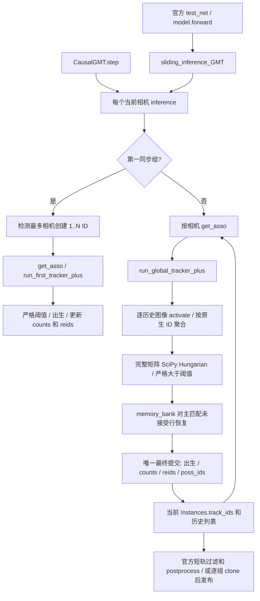

# CIR-GMT 原生接口审计（Phase 0，改造前）

起点：远程 `research/pirga-fulltrain-20261016@f595189e62dac917a4880b1220b3c9ae6d7303aa`。
本文件先于 tracker 改造建立。只继承代码与失败约束，不将旧实验计入本轮成绩。

## 真实状态和顺序

`get_asso` 用现有 1152 维 descriptor、RPCE/GTA。空查询路径仍保留原 Python RNG 消耗。CIR 不替换 Transformer、激活、合法候选和求解器。

初始化先按检测数降序（NumPy argsort 后逆序）选择主相机，其余相机升序。`run_first_tracker_plus` 完成 Hungarian、严格 `>`、出生以及字典写入；第一版只观察，完全不干预。

正常匹配先按历史图像分块激活，再将全部引用按 `torch.unique(ids)` 聚合。接受阈值是 `overlap_thresh * reference_count`（除非原有 NOT_MULT_THRESH）。不能先过滤低分边后宣称等同原分配。

主关联未接受行才进入 Bank。`memory_bank` 会原地 reverse 传入的 older 列表，并将 eligible poss_ids 移入模块全局 `old_reids`；descriptor 是最近 bank_size 条 reids 的均值，并覆盖该 Bank Instances 行的特征。它不是新的物理观测。`run_memory_tracker` 自己进行 Hungarian/严格 Bank 阈值、修改 poss_ids，并从 Bank 删除恢复项。必须保持其调用位置与共享引用关系。

最终提交逐行进行：未接受行增加 id_count、创建 counts/reids；已有 ID 增加 count，在 bank_size+1 时加入 poss_ids，拼接 reids；循环内先设置当前 track_ids 再切片写入字典。当前张量和 Instances 的别名关系不可用浅拷贝假装隔离。最后检查当前相机 ID 唯一。跨相机同一 ID 合法，同一个当前相机的两行不能重复。

Gallery 是 `instances` 历史和其滑动切片，并无独立的原生 Gallery 类。后续帧读取上述 ID、reids、counts、poss_ids、old_reids；另有 old_ids 全局集合（当前恢复路径未活跃使用）。Ledger 不能取代这些状态。

## 两条入口的差异与待验证点

官方入口预加载 view-block 图像，按 frame-major 执行，推理结束做 MIN_TRACK_LEN=50 和可选 delayed classification，再原地 postprocess；返回 `(outputs, view_num)`。MOTEvaluator 已有 view-block→frame-major 对齐修复，属于起点，不修改评价公式。

CausalGMT 按同步组输入，同一共享 first/global/memory 函数，逐组 clone 后 postprocess，原始未过滤状态保留。它不执行完整视频短轨过滤，且最后 timestamp 不同于官方传入的全视频终止时间。必须验证实际特征和轨迹等价，不能直接称它等同官方协议。对原生 RPCE 时间输入另查实际读取位置；若存在未来依赖则披露并分协议比较，不以实验入口替代官方 TEST。

默认 GEO disabled；本轮不启用或改动其开关，不调用 VGGT/DINO/预测器。新增 CIR 普通 Python 对象不注册 nn.Module 参数，OFF 不消耗 RNG，不改变 checkpoint key。

## 工程约束与阶段准入

先抽取 compute / solve / propose / bank / commit 五段，保留原表达式、操作次序与 SciPy 调用。OFF 和 KEEP 对照起点源码真实方法，测试分数、配对、阈值、Bank、出生、完整状态和 RNG。CPU 边界合同通过后做真实图像前缀，再做完整冷启动 OFF。未通过禁止训练及正式 TEST。

已阅读 PIRGA 最终报告和 Phase XVI 最终报告：不继续未来预测；不删历史/硬隔离；WHO/Q4/真实 native state 不一致的方案不允许部署。之前的 HOTA/纠错结果只作失败证据，不填入 CIR 结果。

后续增加 SPLIT/RELINK 前必须完成完整快照、别名恢复、已发布输出封存和真实分支回滚。第一版关闭这些动作，不能以图 alias 映射声称已完成原生修正。
