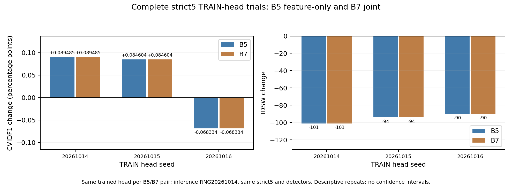
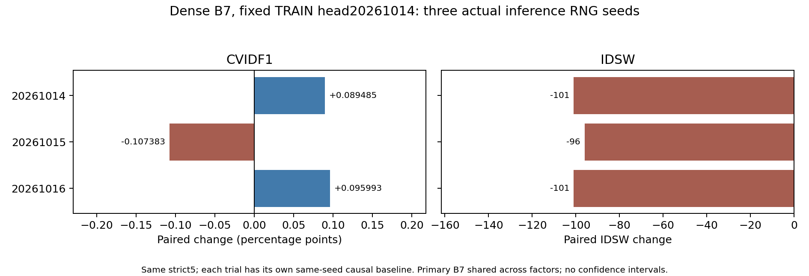

# VGGT+GMT — final scoped research report

The declared experiments and bounded recovery paths are complete under the recorded data/hardware constraints. Stable VGGT-specific improvement, independent geometry benefit and a WWW-ready three-module contribution were not established.

SCIENTIFIC_SUCCESS: paired preliminary signals exist; stable VGGT-specific success is not established. ENGINEERING_COMPLETE: true within the audited scope. PAPER_READY: false.

No JEV decision model, learned weights or perception cache is used. New training/selection uses original TRAIN only. Frozen GMT saw these DEV scenes in original training; historical TEST exposure is disclosed. This is not backbone-unseen or blind-TEST generalization. Strict DEV is [1,10,11,18,19]; seven additional original DEV scenes have conflicting raw GT and separate permissive diagnostics. No labels or metric definitions were repaired to obtain gains.

## Tracking results

Full strict5 pooled native metrics, actual inference20261014. Offline GMT full-video filtering and causal publication have separate baselines. All metrics including DetA/IDF1/CVMA/MOTA remain in ablation_results.csv.

| Primary causal candidate | HOTA | AssA | CVIDF1 | Delta (pp) | IDSW |
|---|---:|---:|---:|---:|---:|
| causal_B0_strict_suite_v1 | 80.748465 | 81.472706 | 95.057962 | +0.000000 | 482 |
| causal_B7_fixed_k1_strict_suite_v1 | 80.821676 | 81.619531 | 95.147448 | +0.089485 | 381 |
| causal_B7_fixed_k5_strict_suite_v1 | 80.752812 | 81.482775 | 95.064470 | +0.006508 | 474 |
| causal_B7_fixed_k10_strict_suite_v1 | 80.744258 | 81.464063 | 95.053081 | -0.004881 | 489 |
| causal_B7_fixed_k20_strict_suite_v1 | 80.749519 | 81.474811 | 95.059589 | +0.001627 | 482 |
| causal_B8_fixed20_total80_strict_suite_v1 | 80.749519 | 81.474811 | 95.059589 | +0.001627 | 482 |
| causal_B9_joint_total80_strict_suite_v1 | 80.748465 | 81.472706 | 95.057962 | +0.000000 | 482 |
| causal_random_total80_strict_suite_v1 | 80.748411 | 81.472596 | 95.057962 | +0.000000 | 482 |
| causal_motion_total80_strict_suite_v1 | 80.748465 | 81.472706 | 95.057962 | +0.000000 | 482 |
| causal_identity_total80_strict_suite_v1 | 80.753105 | 81.481978 | 95.064470 | +0.006508 | 474 |
| C_gmt_head_dense_causal_strict_suite_v1 | 80.803228 | 81.580691 | 95.127924 | +0.069961 | 405 |
| C_dino_head_dense_causal_strict_suite_v1 | 80.823124 | 81.620157 | 95.157210 | +0.099248 | 375 |
| native_prior_seed20261014_strict_suite_v1 | 80.840633 | 81.654465 | 95.181615 | +0.123653 | 351 |
| causal_B5_dense_seed20261014_strict_suite_v1 | 80.821676 | 81.619531 | 95.147448 | +0.089485 | 381 |

The DEV accuracy reference is native_prior_seed20261014_strict_suite_v1 (CVIDF1 95.181615, IDSW 351). It is an ordinary head-free native camera/time prior, with no VGGT calls or new learned weights. It outperforms the primary learned VGGT candidate; it is retained as a control/reference, not claimed as the three proposed innovations. The preselected VGGT TRAIN head20261014 and all other heads remain retained; no seed reselection, new fitting or TEST tuning follows.

## Complete seed factors

| Factor | Method | TRAIN head | Actual inference RNG | Paired CVIDF1 delta (pp) | IDSW |
|---|---|---:|---:|---:|---:|
| training_head_seed | B5 | 20261014 | 20261014 | +0.089485 | 381 |
| training_head_seed | B5 | 20261015 | 20261014 | +0.084604 | 388 |
| training_head_seed | B5 | 20261016 | 20261014 | -0.068334 | 392 |
| training_head_seed | B7 | 20261014 | 20261014 | +0.089485 | 381 |
| training_head_seed | B7 | 20261015 | 20261014 | +0.084604 | 388 |
| training_head_seed | B7 | 20261016 | 20261014 | -0.068334 | 392 |
| inference_rng_seed | B7 | 20261014 | 20261014 | +0.089485 | 381 |
| inference_rng_seed | B7 | 20261014 | 20261015 | -0.107383 | 390 |
| inference_rng_seed | B7 | 20261014 | 20261016 | +0.095993 | 401 |

Every trial is paired to its own same-inference-seed causal baseline, with exact detector membership and fixed effective options/head hashes. Primary B7 is shared across factors. These repeat the same five scenes, not independent datasets; no confidence interval or stable-effect claim. Both factors include a negative CVIDF1 result despite fewer ID switches. The native transformer randomly assigns trajectory embedding indices in evaluation, motivating separate inference-RNG controls.

## Findings for the three ideas

- GCIR: two TRAIN heads improve full-DEV CVIDF1 and one regresses; frozen-head inference trials also change sign. Matched DINO/GMT heads and ordinary native priors prevent unique VGGT attribution. Layer/pool/native/compressed/hard-candidate diagnostics and bounded history TRAIN recovery are retained; this is not a proof that all foundation features are useless.
- DCGA: complete B5/B7 serialized outputs are identical for all three TRAIN heads over strict5. Each joint replay has3 numerical/background gate passes, with no independent final-output effect.420 fixed screening variants accept0 geometry states; these repeat samples and do not establish physical causes. Pose/background/plane/neural and legal temporal branches were exercised; GT-pose accuracy and valid real propagation remain unproved.
- ISGU: fixed/random/joint400-call budgets are measured. B9 equals causal GMT, while B8 gains only+.001627 CVIDF1pp. Identity-only uses218 calls and motion-only0, so they cannot be claimed superior at the same realized400-call budget. Fixed offsets, random seeds and joint repeats on complete scene18 retain baseline outputs. The motion estimator can return0 on failed rotation flow and miss an update.

## Actual decisions and failure analysis

Complete scene1 diagnostic preserves standalone predictions and verifies all4,527 physical detector proposals/common GT labels. There are4,524 common primary queries,32 conditional known corrections,1 known harm and386 uncertain cases. All32 recover missed known positive links;75 correct-link queries become ambiguous-reference. Averaged-descriptor memory decisions are excluded, and each run has its own history. These are pre-memory primary decisions, distinct from final ID correctness and quadratic all-time output-pair counts. [Complete state/transition table](GEO_STREAM_ACTUAL_DECISIONS.md).

Correctness covers full OFF/zero raw parity, explicit camera-input canonicalization, real GPU empty cases, actual prefix causality and constructed/injected texture/nonoverlap/tiny/nonfinite/OOM/timeout/stale branches. Whole-GMT internal order sensitivity remains a measured baseline limitation; canonical physical-ID input passes four40-group variants. Blank/unrelated background and60-degree rotation stress is constructed CPU evidence, not natural UAV pose/overlap truth. The original camera-MLP scalar collapse is documented; its corrected full5 control has equal metrics but5 changed scene18 rows. [Requirement audit](GEO_STREAM_REQUIREMENT_AUDIT.md).

## Runtime, resources and storage

Replay body timing charges image reads, preprocessing/transfers, detection/GTA, feature/geometry work and identity publication; retrieval additionally charges index/query/log I/O. Static setup/import/export costs are separately available from unheld parent-observed process durations. They are not camera capture or HTTP/network latency. For two cameras, per-camera delivered FPS equals synchronized-group FPS, half aggregate camera-image FPS.

| Strict5 setting | Actual VGGT calls | Body camera images/s | Group FPS |
|---|---:|---:|---:|
| causal_B7_fixed_k1_strict_suite_v1 | 14324 | 1.126221 | 0.563111 |
| causal_B7_fixed_k5_strict_suite_v1 | 2870 | 3.458327 | 1.729163 |
| causal_B7_fixed_k10_strict_suite_v1 | 1438 | 4.405587 | 2.202793 |
| causal_B7_fixed_k20_strict_suite_v1 | 720 | 5.059706 | 2.529853 |
| causal_identity_total80_strict_suite_v1 | 218 | 5.934358 | 2.967179 |

Primary dense joint process throughput is 1.119196 images/s versus body 1.126221. The audit has 127 complete unheld processes/17 strict5 process suites, with 8 held/overlap/superseded-child outer costs explicitly unavailable, not zero. These descriptive replays do not establish stable speed or real-time operation. [Process cost](GEO_STREAM_PROCESS_WALL_RUNTIME.md).

Frozen GMT has 53,515,309 parameters, strict411 checkpoint keys. Official full VGGT has1,256,537,516 parameters; the pruned resident constructor has1,125,286,930, a structural count distinct from measured GPU memory. Matched head counts309,319/309,849/310,402. Per-process CUDA allocator/RSS, whole-device sampled NVML, final history and bounded index/vector payloads are separate; neither noncoincident peaks nor RSS/probe overlaps are summed. Original GMT history is unbounded, and index caps are not total-system memory caps. [Sampled resources](GEO_STREAM_SAMPLED_RESOURCES.md), [storage](GEO_STREAM_STORAGE_BUDGET.md).

Hardware is the observed V100 system, at most project GPUs0/4/5/6, not A100. The available FastVGGT short-pair FP16 reference is about2.12–2.15times slower on this setup; original BF16 failures/bridges remain separate. StreamVGGT is a differently trained KV architecture, not a lossless frozen-weight switch. No production integration, long-sequence or other-hardware multiplier is inferred.

## Multi-stream retrieval and WWW suitability

Real local image/detector/GTA/feature/index/query producers cover2/4/10 streams. All12 declared physical-query comparisons complete; positive gallery labels are strictly post-run, scene-qualified, majority over all clip observations including unmatched ones. Conditional Recall/MRR, detector coverage, gallery eligibility and all-request success remain separate.

Dense VGGT tracking plus native ranking corrects one scene18 query among309 eligible/598 requests; Recall1 rises .977346→.980583. DINO tracking has the same aggregate Recall1 and higher MRR, while correcting a different query, so equal scores do not establish the same correction or unique foundation evidence. Four-camera scene1 DINO has1 correction/1 harm despite unchanged aggregate Recall1; uncertainty and rank harms remain retained. Raw VGGT-feature ten-camera ranking is worse than native ranking on the fixed scene18 cohort (.705502 versus .841424). [Query audit](GEO_STREAM_RETRIEVAL_QUERY_AUDIT.md).

Local replay and local query latency do not establish Internet-source provenance, live Web deployment, real-user traffic or an independent WWW scientific contribution. PAPER_READY remains false. [WWW scope](WWW_SCOPE_NOTE.md), [all15 reviewer answers](REVIEWER_QUESTIONS.md).

## Reproduction and retained limitations

[Execution/source instructions](GEO_STREAM_REPRODUCIBILITY.md), [source/license audit](GEOMETRY_OPEN_SOURCE_AUDIT.md), [machine completion audit](../results/final_completion_audit_v1.json), [candidate record](../results/final_candidate_selection_v1.json). Named CSVs, native metrics and experiment manifests are generated from retained artifacts; hashes and source commits bind inputs. Original failed/invalid fixtures, old checker failures, weaker legacy dirty-source provenance and unavailable loaded-file/library/coverage facts are retained rather than relabeled. No raw dataset, large checkpoint, dense token cache or log bulk is added to Git.
