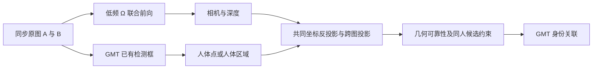

# 双视角 Ω 重建能否验证同人，以及 FPS 成本

研究日期：2026-10-21。独立研究分支 `research/omega-pair-geometry-fps-20261021`，基于 `c98c024e`。仅使用已核验的原版 Ω 512 权重；不是 416 复现，不涉及 JEV。此前 GMT 准入门槛保持关闭。

## 结论

两张同步图像可以直接输入 Ω，获得同一次前向中的相机内外参与两张深度图，再把原图中的人物检测提升到共同坐标系，用位置、重投影和遮挡一致性帮助关联。无需先渲染三维场景，也无需先训练三维人体检测器。若 GMT 已有检测框，应直接复用这些框。

这条路线在本次固定开发面板上产生了身份候选排序信号，但仍有较多错误，不能独立决定同人，尚未证明 GMT 的身份指标提升。速度上，逐帧完整重建在本机 V100 上成本较高；优先研究可靠几何的缓存/低频更新，以及现有检测和图像解码的复用。

## 官方能力与代码核验

[官方推理实现](https://github.com/facebookresearch/vggt-omega/blob/48b23c8ce72c9a8fcf987f0d7f43d8e4870759f6/vggt_omega/models/vggt_omega.py) 接收 `[B,S,3,H,W]`；两图时 `S=2`。主要输出为 `pose_enc`、`depth`、`depth_conf` 和 camera/register tokens。512 权重没有现成的人体身份分类头、3D 人体检测器或跨时刻身份轨迹输出。点云可通过相机和深度反投影获得。

[Ω 论文 3.3 节](https://arxiv.org/html/2605.15195v1#S3.SS3)说明模型支持动态场景，但输出仍是相机与深度；支持运动场景不等于自动恢复每个人的持久身份。论文还记录了人体、黑色衣物等区域的深度伪影风险。

此前 FullTRAIN 提取器其实已将同步双图共同送入 Ω aggregator，再提取 2048D ROI token；此前对话将其说成“真正独立单图输入”是错误的。与本研究的区别在于：先前没有用 pose/depth 做共同三维空间关联，不能把先前 +5 的诊断解释成几何重建收益。

## 建议的计算路线

对 camera-from-world 外参 `[R_i|t_i]`，像素 `(u,v)`、深度 `d` 的反投影为：

`X_world = R_i^T (d K_i^-1 [u,v,1]^T - t_i)`。

必须使用同一次双图联合推理的相机和深度。同一个人两侧可见的表面不同，两个 bbox 中心不一定是同一个三维点，因此不能直接要求两个框中心的三维坐标相等。可用人体分割区域、可见关键点、脚点和局部深度的稳健支持；拥挤、遮挡或几何不可靠时应弃权。

两路最好同步且有共同场景支持。异步画面中同一个人已经移动；没有共同视野/场景锚点时，单靠两张图一般难以可靠确定相对几何。不同次前向的尺度和坐标基准也可能不同，跨时刻使用三维轨迹必须进行地图/尺度对齐。

固定、已验证几何的相机可缓存相机关系和地面映射；若相机移动，不能冻结外参。可以低频 Ω 初始化/校正，再用可靠的背景定位更新相机位姿；地面近似成立时再使用脚点投影。这是架构建议，尚未在本项目实施在线系统。[官方地面融合示例](https://www.mathworks.com/help/vision/ug/track-objects-across-multiple-cameras-using-ground-plane-fusion.html)同样要求已知的相机参数和有效参考平面。

## 固定实验与数据范围

先提交并推送 `1fd142c8` 的方案，再做新推理。采用此前 18 个 fit 场景，每场景时间轴 10%、50%、90% 的同步双图，共 54 对，不按 Ω 输出挑样本。四张物理 V100（2、3、4、5）并行运行四种输入规格。全部使用 512 原版权重，SHA256 `c02da418b18bb01d0392598d3f6147366bcde1bb70fd08a5e3bf7925b0667934`；384/256 是降低输入尺寸的工程试验，不是其他官方检查点。

输入采用原图和之前冻结的公开检测框，推理不读取身份标签。原始 TRAIN schema 在推理前检查；数值身份比较在推理产物固定后进行。原始 TRAIN 已用于先前开发，因此不声称盲验证。原始 GT 中同视角同帧重复的 instance_id 全部排除；检测与 GT 只用互为最佳、IoU >= 0.5 的匹配。只统计对侧同时有合法正例和负例的查询。

固定主规则：框内 5×7 点反投影到对侧，检查是否进入候选框以及相对深度误差 <= 10%，双向支持取几何均值；全零、并列或深度无效时弃权。另保留共同坐标脚点距离对照。阈值未根据结果修改。这是检测框上的粗几何探针，并非人体分割重建或经过校准的同人分类器。

## 速度实测

硬件是 Tesla V100-DGXS-32GB，PyTorch 2.6.0+cu118。FP16 aggregator，官方 FP32 camera/depth 输出头。模型常驻，5 次暖机后在全部 54 对真实图像上计时，每次 CUDA 同步；单位为一个双摄像头同步时刻，不是单张图片。输入 RGB decode/resize/H2D 与模型时间分别记录。保存 NPZ、渲染、磁盘导出不计入单对延迟；模型加载约 38–44 秒单列。以下重建时间不含检测、GMT 或 CPU 身份候选打分。

| 同一次前向的两张输入 | Eager P50 ms/对 | CUDA Graph P50 / P95 ms/对 | Graph 模型吞吐 对/秒 | Graph 读图到几何 P50 ms/对 |
|---|---:|---:|---:|---:|
| 688×384，balanced512 | 173.5 | 172.4 / 172.7 | 5.80 | 265.1 |
| 512×288，max512 | 113.3 | 100.6 / 100.8 | 9.93 | 189.6 |
| 384×224，max384 | 110.3 | 69.5 / 69.7 | 14.39 | 146.0 |
| 256×144，max256 | 107.9 | 47.2 / 47.2 | 21.18 | 125.9 |

CUDA Graph 的四种规格、全部 216 个物理配置图像对，与 eager 的 depth、confidence、extrinsics、intrinsics 逐项比较，最大归一化差异均为 **0**；未改变权重或数值输出。Graph 设置耗时约 0.68–1.05 秒，未计入稳态延迟。Graph 峰值 allocated 约 4.29–4.31 GiB，为单独 Ω 进程的总量，不是与 GMT 共存后的额外显存。

Eager max512 的 batch=4 吞吐为 12.74 对/秒，但整批延迟约 314 ms，且使用重复图像对作容量探针。吞吐与单对交付延迟不能互换。四卡也不能把单对延迟直接除以四；按时间戳并行还要测预处理、队列、按序提交和因果历史。

### 首轮 BF16 问题及保留记录

PyTorch 2.6 在本机 V100 上的 `torch.cuda.is_bf16_supported()` 返回 true，但 `including_emulation=False` 返回 false。官方默认自动选择因而采用 BF16。首轮 manifest 错写成 FP16，实际完整前向 P50 为 max512 342.7 ms、balanced512 719.3 ms。所有原始 manifest、日志和预测均保留，未覆盖；专门审计记录元数据错误。

随后用 `VGGTOmega(autocast=False)` 加显式外层 FP16，内部 FP32 输出头保持原样，执行完全相同的 54 对和全部规格。第一轮不能混入“原生 FP16”的速度表。CUDA Graph 后续方案也在运行前固定，并保留全部规格，无结果驱动的阈值选择。

## 粗几何是否真的能区分候选

以下是两方向合计 764 个可比候选行，来自 54 个物理图像对；同一物理对的两方向相关，不能当成 764 个独立人物。因为每行保证存在正负候选，这些数值不涵盖“对侧根本没有该人”的开放集合判别。

| 输入规格 | 正确排序 | 错误排序 | 弃权 | 已回答行正确率 |
|---|---:|---:|---:|---:|
| balanced512 | 635 | 96 | 33 | 86.87% |
| max512 | 514 | 135 | 115 | 79.20% |
| max384 | 304 | 147 | 313 | 67.41% |
| max256 | 166 | 157 | 441 | 51.39% |

max512 下检测框高度中位数仅 18.5 个网络像素；max256 下为 9.3 像素，P10 仅 4.8 像素。降采样让人体几何信息迅速丢失。脚点距离对照正确排序分别为 540、511、450、332 / 764，说明“最近三维脚点”也不能直接作为身份真值。

NumPy/OpenCV 粗几何后处理 P50 约 5.9–11.2 ms/图像对，但 P95 为 42.8–70.2 ms；这是当前 Python 探针的实测开销，不能忽略尾延迟。它使用检测框、深度和投影，无三维检测器。若部署逐帧版本，需进一步批量采样/向量化或移到 GPU，尚未计入优化收益。新探针没有进行独立背景几何可靠性认证，也没有运行真实 Hungarian/阈值/Bank/后续身份传播；因此上述候选排序不构成最终 ID 纠错或 GMT 收益。既有独立背景审计曾只有 13/96 对满足共同可靠性门槛，且集中于两个场景，也要求后续将几何可靠性作为独立条件。

## GMT 本身的速度范围与设计建议

另对 scene2、scene8、scene17 各跑了连续前 100 个同步时刻的原生 CausalGMT，排除前 10 个暖机时刻，实时读取当前图像，无检测缓存。包含读图、预处理、两路检测、因果关联与输出后处理，得到 4.11、3.78、3.68 个同步时刻/秒。它们是短前缀速度，不能称为完整视频 FPS 或 GMT+Ω 系统 FPS。

scene17 的平均 271.6 ms 中，读图/预处理约 122.8 ms，tracker.step 约 148.8 ms。这说明即使 Ω 免费，当前基线在这条测量路径上也还达不到 20/30 FPS。将同一 RGB 图像再次给 Ω 读盘会重复支付 decode/resize 成本，集成时应先共享解码、复用 GMT 检测框、并行预处理，再评估真正的系统瓶颈。

推荐分情况设计：

1. 固定相机且几何经独立验证：用 Ω 低频/初始化重建静态背景与相机几何，逐帧只做人物检测、少量投影与关联。地面近似必须验证；有人移动不要求每帧重新构建整个场景。
2. 移动相机：低频 Ω 校正相机/地图，中间时刻做轻量背景位姿更新。必须记录地图对齐、几何年龄、漂移和弃权，不能缓存旧人体位置冒充当前坐标。
3. 如需逐帧 Ω：先保留 max512 的质量，再探索固定形状执行、跨卡流水线、共享解码和必要时的轻量几何学生模型。256 虽达 21.2 次/秒的模型吞吐，但本面板错误与弃权过多，不能凭速度采用。
4. 每个同步时刻只对完整双图做一次 Ω，供全部人物共享相机/深度；不要对每一对人物重新调用 Ω。两侧各有 N、M 人时，后者会把重建调用放大为 N×M。

`T_serial ≈ T_GMT + T_Ω/K + T_geometry` 只能做预算估算，其中 K 是更新间隔；异步系统需另外量化排队和几何陈旧性。20 FPS 每时刻只有 50 ms，30 FPS 只有 33.3 ms，当前 max512 完整重建单模块已超出这两个预算。低频更新与完整身份关联仍需固定新协议验证，不能放松之前的准入门槛。

## 产物与限制

- 机器审计：`results/omega_pair_reconstruction_fps_research_v1.json`。
- 原始排序摘要：`results/omega_pair_geometry_fps_probe_v1.json`；全部分数矩阵、标签对照和所有输入规格预测位于外部 runtime，摘要绑定 SHA256。
- 精度元数据修正：`results/omega_pair_precision_implementation_audit_v1.json`。
- 所有首轮 BF16、显式 FP16、CUDA Graph 的完整预测、失败/状态和日志均在 `/data1/liuyeqiang/WWW_omega_pair_geometry_runtime_20261021`，没有覆盖前序产物。
- 本次不训练 Ω 或 GMT，不改变生产关联路径；完整 GMT+Ω 在线系统 FPS、HOTA、IDF1、官方 TEST 和 416 复现均未执行。
