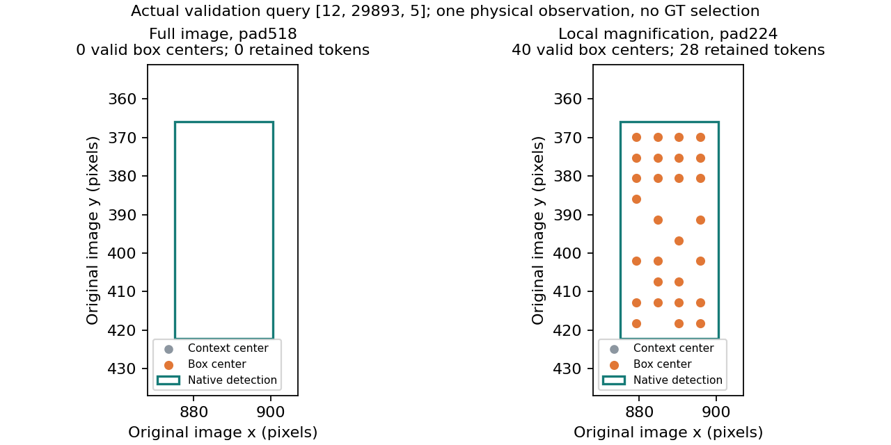

# TrackVGGT teacher results

Final status: COMPLETE_REGISTERED_TEACHER_SCREENING; all56 registered runs
complete, gate NO_UNIQUE_VGGT_TEACHER_EVIDENCE. Crops/QD/cycles and all fresh
native system cases are complete; conditional IRGD/students are unexecuted.
The explicitly labelled registration snapshot below is historical, with actual
completed outcomes in the following sections and final report.

Primary seed20261015; unchanged original300 validation requests,100 with a certified pure-positive candidate. Native and NativePrior Recall@1=.66. Unknown/impure references are not certified wrong. Pair ranking is an intermediate diagnostic; none of these numbers is a full Hungarian/Bank/final-tracking correction.

|Cohort|Backbone / head|Summary|Recall@1|Shuffled|Known ranking fixes / harms|
|---|---|---|---:|---:|---:|
|V2 1000|vggt/C|mean|0.07|0.34|0 / 56|
|V2 1000|vggt/C|ema|0.14|0.46|0 / 39|
|V2 1000|vggt/A|mean|0.07|0.33|0 / 55|
|V2 1000|vggt/B|mean|0.08|0.34|0 / 55|
|V2 1000|dinov2/C|mean|0.24|0.44|0 / 20|
|V2 1000|dinov2/roi|mean|0.18|0.45|0 / 38|
|V2 1000|vggt/roi|mean|0.07|0.39|0 / 56|
|V2 1000|vggt/native MLP|mean|0.63|0.65|0 / 2|
|V3 3000|vggt/C|mean|0.54|0.47|1 / 3|
|V3 3000|vggt/roi|mean|0.66|0.56|2 / 1|
|V3 3000|dinov2/C|mean|0.46|0.48|1 / 4|
|V3 3000|vggt/native MLP|mean|0.66|0.66|1 / 0|

All settings above complete1000 total optimizer updates, including the original150-step pilots with exact optimizer/RNG continuation. V3 improves AG-C from.07 to.54 but remains below native/.66 and pooledROI/.66. DINO AG-C V3=.46; this VGGT-vs-DINO difference alone does not establish unique benefit because stronger native/ROI controls remain superior. V3 nativeMLP=.66, with one certified ranking fix and zero certified harms; uncertified transitions are separately reported in the machine audit.

The K16/24/32 ablation uses the same fitted V3 AG-C K24 checkpoint and fixed300 inputs: all three give Recall@1=.54. This is an inference-budget ablation, not independently retrained K models. CPU K24 reproduces all GPU discrete query ranks/states, with floating-point logit differences disclosed in its receipt.

The full per-size-bin and paired-key audit is results/trackvggt_ag_v2_v3_primary_results_v1.json. Native correct-to-ambiguous/uncertified transitions are separate from known harms. All primary GT-unknown requests remain in the denominator-preserving reports.

## Historical registration snapshot: finite repairs and independent hypotheses

One bounded native-box224 crop comparison is fixed at256 fit queries by scene/hash round robin and the original300 validation. No new DEV12 release input/error is used. Full/local/combined variants preserve exactly the native vectors, candidate histories, scores, labels and supervised query population. Full-image zero-center draws use their genuine native fallback and exactly zero learned gradient; these draws are explicitly counted, rather than silently removed from the full branch. Both backbones have556 completed crop targets; all shared NPZ bytes1591956497 <2147483648. Actual crop extraction/probes cost.139091908GPU-wall-hours. No dense map, raw image copy or invented camera is stored. Crop fit results remain separate from full3000-fit results.

All five ordinary/track QD variants and matched global/track DINO controls are registered in manifests/trackvggt_qd_fit_v1.json. The native MLP at QD capacity2132697 parameters is separately registered. VGGT global/track QD have2123016 and matching DINO2126488 trainable parameters; lighter last-layer controls disclose their smaller capacity. At registration, the globalQD pilot produced one constant across-query layer-weight distribution, as expected. Full fits and dynamic-query effects are not inferred from this pilot.

Actual cycle relation materialization and fitted-AG gradient checks pass on the locked128-query V3 scope:63 visible chains, B<=4, actual previous/current source keys and earlier-native score evidence. P_AB/P_BA/P_AA include explicit NULL and separate legal/visible GT masks. A_current is one actual selected detection plus NULL, a disclosed bounded subset rather than a full-scene matrix. At registration, formal temporal benefit was unmeasured pending identical-source no-cycle trackQD1000 checkpoints and matched200-update lambda0/.1 continuations; the completed results follow below. Both controls execute the same cycle forwards to preserve dropout consumption and record actual native minibatch/cycle-schedule hashes. No lambda.2 escalation is registered.

Completed report snapshots are generated from actual manifests into results/teacher_ablation.csv;150/1000 entries are different budgets, never interchangeable or best-iteration selection. QD/crop/control/cycle queue receipts are recorded with actual process identities (all those controllers have now exited) in results/trackvggt_teacher_execution_snapshot_v1.json.

Historical snapshot status: primary AG had not demonstrated independent VGGT teacher benefit; crop/QD/temporal hypotheses were executing or waiting. They are all complete in the final results below. IRGD, student success, scientific success and paper readiness remain unproven.

## Completed fixed224 repair

All six same256-fit/300-validation comparisons now finish1000 updates:

|Backbone|Full|Local224|Full+local|
|---|---:|---:|---:|
|VGGT|0.32|0.44|0.41|
|Matched DINO|0.37|0.51|0.46|

These use234 common candidate-backed, GT-eligible training queries; all256 remain
in fit evaluation. The terminal NumPy draw state and CPU/CUDA Torch RNG states
match exactly across all three variants within each backbone. Full-image native
fallbacks contribute350 neutral draws during the850-step continuation; local and
combined have valid native-box tokens. Raw checkpoints are unchanged. The actual
query-order/eligibility code and terminal RNG agreement verify the matched draw
schedule; individual batch keys were not separately logged in these crop fits.
The completed audit includes all per-query known fixes/harms, ambiguous changes,
original size bins and matched DINO overlap. All300 requests are retained; all
Recall@1 values above have100 certified pure-positive ranking queries as their
denominator. All remain below native/.66; magnification helps both backbones and
does not establish unique VGGT identity information.

This coordinate-only example is the first original validation key with an observed
zero-center full-image ROI. It copies no image and reads no GT. The local crop has
40 valid native-box centers,28 retained positions; the original full pool is empty.
The detector's native1152 feature remains available and is used for the original
neutral fallback; the interpolated ROIAlign control also remains defined. A denser
sampling grid is not evidence of correct identity association.

## Completed VGGT QD primary fits and temporal pair

The five no-cycle VGGT QD variants finish1000 updates: last=.25, fixed mean=.24,
concat=.23, global See-Query=.24, track-conditioned See-Query=.25. Active capacity
is1284996/2072580/2138244/2123016/2123016 respectively. The matched native-only
QD-capacity MLP has2132697 parameters and Recall@1=.67. Matched DINO global/track
and DINO cycle controls remain pending at this snapshot; they are not inferred.

Track-conditioned QD's candidate-aligned layer-weight change under history
permutation has mean L1=.511537671; global See-Query is exactly zero. The shuffled
weights match the corresponding actually permuted query weights. Means/stds over
that same candidate-query multiset are permutation invariant, so their aggregate
agreement is not evidence of an inactive conditioning module. The whole query is
permuted for AG/decoder/See-Query, while image and native pair evidence remain fixed;
this does not isolate the See-Query performance effect from the other query paths.
The track model's Recall@1 improves from.25 to.39 when history is shuffled, which
contradicts useful identity conditioning in this tested setting.

From that fixed trackQD1000 checkpoint, lambda0 and.1 each perform200 additional
updates with identical source weights/optimizer/RNG, native batch draw hashes,
cycle-key schedules and final NumPy/Torch/dropout RNG states. Initial association
and cycle losses match exactly.128 fixed cycles yield106 visible draws across200
updates. The final Recall@1 is.22/.23. The sole extra certified success at
[12,30269,2] replaces an ambiguous reference from the no-cycle continuation; native
GMT already ranks that query correctly. There are zero certified wrong-link fixes
and zero certified known harms between these two continuations. Mean observed
cycle loss falls.03238→.03082, but this is not independent identity/solver benefit.
No lambda.2 expansion is justified by this weak, unreplicated ambiguity transition;
there is no IRGD/student admission.

A reporting defect is retained and corrected explicitly: pinned0eb9af7f's cycle
fitter called generic provenance() with default native inference seed20261014,
while executed seed_all(settings.training_seed) and restored checkpoint/RNG use
training seed20261015. The raw checkpoint settings and actual source/RNG evidence
resolve15; the native inference seed remains14. The raw files/logs/checkpoint SHAs
are untouched. The paired audit and teacher CSV retain the original generic seed,
flag the correction and report the actual training seed separately. Pending DINO
continuations stay on the same pinned source and will receive the same explicit
seed-resolution audit. Future main-branch fitter metadata uses the training seed.

Saved150/1000 endpoints have also been evaluated retrospectively on at most256
scene/hash-selected original fit queries. This is not a reconstructed online
training Recall curve and does not select a best iteration. Examples: V2 AG-C
fit R1=.8257 vs retained validation.07; V3 AG-C fit=.7253 vs.54; local-crop VGGT
fit=.8541 vs.44. Original native fit values on those respective subsets are
.7844/.6652/.6652. Fit populations differ between protocols, and low loss or good
fit ranking does not establish held-out identity utility. The endpoint snapshot
marks uncompleted cases pending and preserves their exact checkpoint hashes.

The next completed DINO global-QD control gives R1=.19 (query shuffle=.42),
versus VGGT global=.24. Both share the same one known native-ranking fix
[12,30266,7], with12/6 known harms respectively. This is a single seed and
poor absolute ranking performance, not a validated VGGT benefit. The QD audit
now contains6 completed cases and1 pending DINO track-QD case; the matched
DINO temporal control is still pending. No missing result is imputed.

Retained-endpoint diagnostics have advanced to51 completed/1 pending checkpoint
by reusing the original saved artifacts and evaluating only newly finished cases.
DINO global-QD fit R1=.7124 versus validation.19 and VGGT concat fit=.6824 versus
validation.23. The remaining endpoint is DINO track-QD1000. This adds no training,
model selection, second seed or reconstructed intermediate curve.

All seven QD full1000 settings are now complete. DINO global/track give
R1=.19/.31 (shuffle.42/.31), versus VGGT global/track .24/.25
(shuffle.36/.39) and native .66. DINO track has1 known native-ranking fix
and2 harms; VGGT track has1 fix and6 harms. Their corresponding track-QD
fix keys differ: VGGT [12,30266,7], DINO [12,29963,6]. Thus the VGGT fix is
not reproduced by that particular matched track-QD control; it is reproduced
by DINO global-QD and the independently matched V3 DINO AG-C. We do not claim
zero distinct fixes against every individual DINO configuration. This does
not establish a beneficial VGGT teacher: absolute ranks and harm counts favor
DINO track, ROI/native remain much stronger, and actual original primary errors
are absent in the fixed300. DINO track layer weights respond to history shuffle
(candidate-aligned L1=.657034807) while its R1 stays.31. Source/native input,
validation label/order and all control artifacts pass the completed QD audit.
DINO lambda0/.1 temporal continuations have started automatically from this
fixed no-cycle DINO track checkpoint.

The retained hard-inference fit-endpoint audit is now COMPLETE: all52 registered
no-cycle150/1000 checkpoints, no pending case. DINO track fit R1=.7167 versus
validation.31. The ordinary teacher table contains52 no-cycle endpoints plus
the two completed VGGT temporal endpoints; DINO temporal endpoints remain running.

All56 registered teacher runs now complete (52 no-cycle endpoints,4 matched
temporal continuations). DINO lambda0/.1 R1=.21/.20, shuffle.38/.38. Initial
losses, source checkpoint, exact ordinary/cycle schedules and terminal NumPy/CPU/
CUDA RNG match. No certified known-ranking fixes or harms between DINO controls;
one correct->ambiguous query[12,30151,7] explains the one-point R1 reduction.
Average observed cycle loss.064899265->.058840747 is training consistency only.
Both raw cycle manifests retain the default seed14 reporting defect; actual
source/settings/RNG seed15 is audited separately, with no artifact rewriting.

The final primary-screening relation gate is NO_UNIQUE_VGGT_TEACHER_EVIDENCE.
Some individual numerical directions favor VGGT (cycle.23 versusDINO.20 and
track.25 versusglobal.24); these do not overcome the failed ROI/native/DINO-track
comparisons, absent useful shuffle degradation, no replicated native-identity
benefit and the known ranking/solver distinction. No lambda.2 escalation or
IRGD/conditional students are executed. This closes the registered teacher
screening only. Fresh full native system/retrieval/strict5 tests and the overall
requirement audit remain necessary.

A final source-based eligibility audit qualifies the control matching. The full
V3 cohort is shared, but visual AG/QD uses2201 effective supervised queries
(2194 positive+7NULL), native/ROI uses2733 (2721+12);532 supervised zero-center
queries have no visual gradient and267 other queries remain masked. Exact
VGGT/DINO visual eligible-key order hashes agree. QD also reuses its separately
fitted1000-update AG initialization; nativeMLP has no such upstream training.
Thus native/ROI results are same-task/capacity controls, not identical-gradient-
population or identical-total-upstream-budget controls. The strict234-query
crop comparison and matched DINO/temporal evidence are separately preserved.
Do not infer an intrinsic visual-feature failure from native/ROI differences
alone or retrofit completed datasets to conceal them. All eligibility counts
remain explicit in the raw manifests/teacher CSV; no additional model update.
