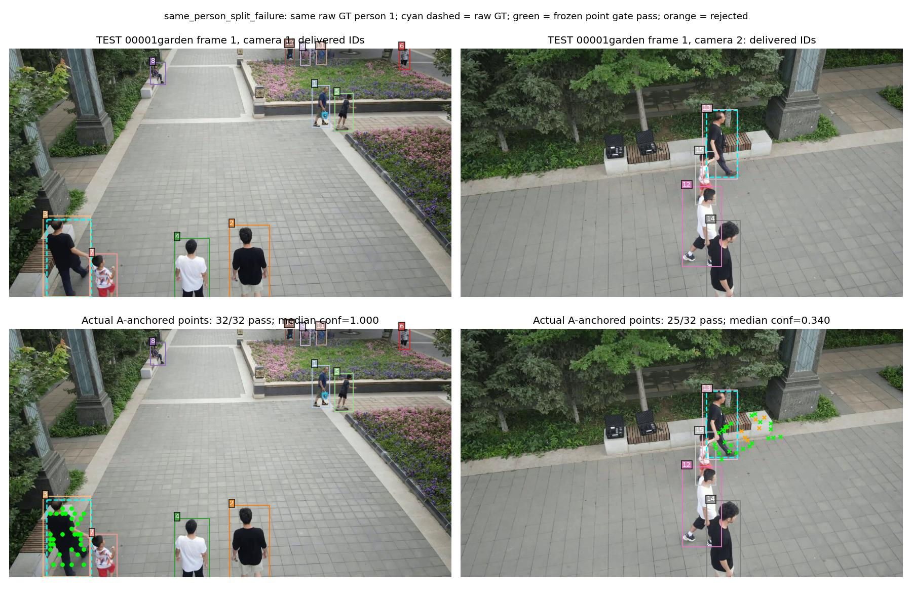
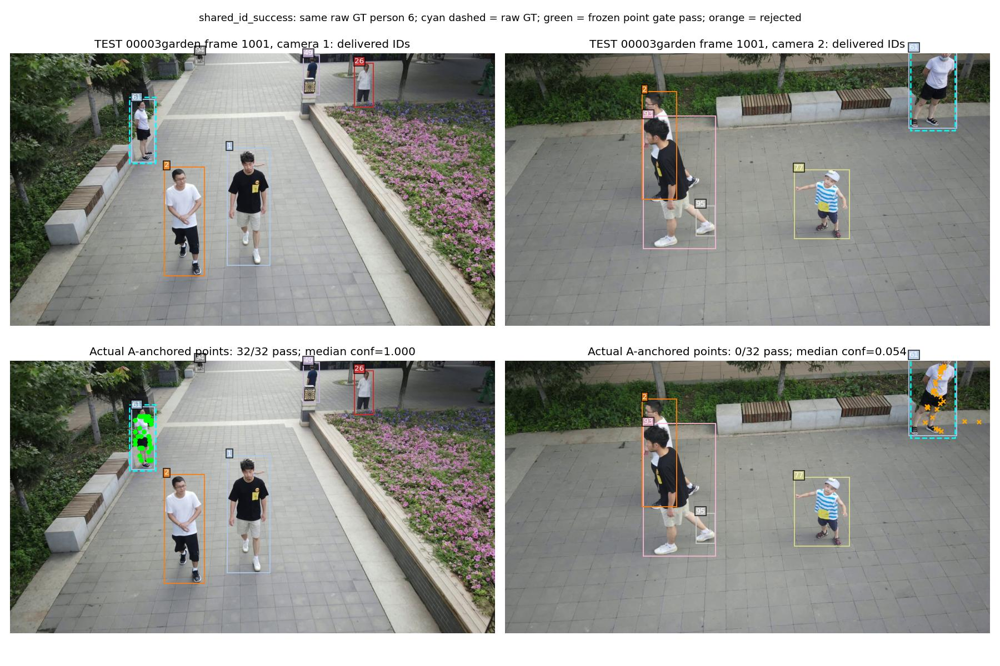

# Complete-video reporting audit, 2026-10-24

The first effect check has official results for all eight completed new
routes: A0, A1, GMTDet+V1, V2 joint seed22/seed23, V2 no-geometry seed22,
and VGGT point temporal/joint. Each route inferred 22 videos and 29,019
synchronized dual-camera timestamps. The official common scoring scope is
the original 14 legal raw-GT scenes. The user's later instruction stops new
multi-seed work; seed24 is cancelled and has no official score. The completed
seed23 remains a separately reported observation. The older RTMDet three-seed
reference was completed previously.

## Provenance correction

The earlier seed22 Gate pointed to SHA
`97079638f3671cc9d52c34af5ca06b48d901c51fafe0f1ebfe788fbe7da749ee`, which
is the preserved `joint_seed20261022_legal14_complete/metrics.json` file. Its
coverage array has 14 entries. The report at
`test_gmt_v2_evaluation/joint_seed20261022/metrics.json` has all 22 inference
entries and eight explicit GT blocks; its SHA is
`4ec30c291e8cc49b82ce149dda227efafe54d57260bad2dc80a079689775bb84`.
The complete `TrackEval` and `VisionTrack_MATLAB` objects are exactly equal,
including per-scene/per-camera values and tool hashes. Only `coverage` and
`blocked` differ. The Gate now records both SHAs and points to the complete
report. No prediction, GT or score was edited.

## Reproducible report generation

The old report builder still used `2d_controls_v1` and obsolete V2 paths,
which would replace completed rows with pending placeholders. The new builder
validates official status, frozen Gate metric SHA, TRAIN-only selection,
full-video manifests, original GT scope and manifest-to-evaluator prediction
SHAs before writing the comparison.

```bash
PYTHONPATH=.:scripts CUDA_VISIBLE_DEVICES='' \
  /data1/liuyeqiang/envs/worldmot311/bin/python \
  scripts/build_gmt_point_comparison.py

PYTHONPATH=.:scripts CUDA_VISIBLE_DEVICES='' \
  /data1/liuyeqiang/envs/worldmot311/bin/python -m pytest -q \
  tests/test_gmt_point_reporting.py
```

The five reporting tests pass. They verify wall-time throughput, exclusion
of cancelled seed24, deterministic one-to-one diagnostic matching, rejection
of changed metric files, and rejection of a manifest from another prediction
attempt. They do not replace the real-video evidence.

Generated tables include the required primary JSON/CSV, official per-scene
and per-camera CSVs, the unified stage timing CSV, per-scene wall-time FPS,
and a metric/manifest evidence inventory with absolute paths, sizes and SHAs.
The real rebuild passed with 18 comparison rows, 238 scene rows and 476 camera
rows. All eight completed new routes passed their frozen official Gate checks.
Primary `E2E_FPS` consistently means total timestamps divided by summed
full-video wall seconds. Earlier hand-maintained new-route rows used scene
arithmetic means, while the native reference used frame-weighted throughput.
Scene arithmetic and harmonic means now have their own columns. This is a
reporting correction, not a new benchmark run. Shared-GPU runs do not establish
an exclusive hardware latency ranking. The native full-video final-ID
delivery convention remains explicit.

## Full-video post-hoc error attribution

```bash
PYTHONPATH=.:scripts CUDA_VISIBLE_DEVICES='' \
  /data1/liuyeqiang/envs/worldmot311/bin/python -u \
  scripts/analyze_gmt_point_test.py --workers 4 \
  --output /data1/liuyeqiang/nas/A100/WorldMOT/final_comparison_20261023/posthoc_test_attribution_20261024_v1.json

PYTHONPATH=.:scripts CUDA_VISIBLE_DEVICES='' \
  /data1/liuyeqiang/envs/worldmot311/bin/python \
  scripts/build_gmt_point_comparison.py --attach-diagnostics-only \
  --diagnostics /data1/liuyeqiang/nas/A100/WorldMOT/final_comparison_20261023/posthoc_test_attribution_20261024_v1.json
```

This CPU analysis reads original raw person GT only after inference. It
rehashes all 176 completed prediction files, scores diagnostics only on the
14 legal scenes, and checks identical normalized raw candidate streams across
all eight methods. It counts raw detector TP/FP/FN, detections lost after
association, same-person split IDs, different-person merged IDs, selected
temporal assignment consistency, rejected point evidence, query NULL/birth/
capacity rejections and alignment/geometry exposures. It groups GT recall by
size, crowd density and raw visibility when available. Diagnostic IoU is .5;
these counts are not official HOTA/IDF1/CVIDF1. An observation-gap bin is not
proof that occlusion caused an identity change. Alignment failures and
unreliable geometry are exposures, not automatically the cause of every
identity error. Dense true point correspondence is unavailable.

The analysis completed all 176 files and passed the identical-candidate
stream check for every legal scene across all eight methods. The completed
TEST report is attached as `results/gmt_vggt_point_error_attribution.json`,
with the compact `gmt_vggt_point_error_summary.csv`. Each method uses 19,103
legal synchronized timestamps, 186,158 raw candidates and the same 189,785
raw person GT boxes. The fixed-IoU diagnostic finds 165,351 raw detector TP,
20,807 FP and 24,434 FN. These greedy-match counts differ slightly from the
official evaluator and are labelled diagnostics.

The point-joint route has 163,043 correct identity transfers out of 163,786
selected temporal assignments with known GT identity (99.546%). However,
only 14,428 / 54,452 both-view same-person detection events receive the
correct shared ID (26.497%); 40,024 remain split and 3,223 different-person
cross-view shared-ID events are observed. These are person/timestamp events,
not unique people. Positive synchronous cross-view candidate edges have
1,907 / 2,427 correct GT identities (78.574%), distinct from selected matches
and distinct from dense point accuracy.

V2 seed22 correctly shares 43,512 / 54,452 IDs (79.909%), with 2,906 wrong
cross-view shared-ID events. It drops 22,335 candidates through explicit
NULL/birth rejection, including 11,615 raw-GT matched detections. The matched
no-geometry route loses 20,740 matched detections; geometry retains 9,125
additional true detections, while wrong shared-ID events increase by 248.
Thus the official geometry ablation gain includes output-retention effects
and is not proof of pure geometric identity correction.

V1 has stronger same-person synchronous sharing (86.467%) but loses 28,019
matched detections and exhibits 3,068 diagnostic temporal label changes,
versus 690 for V2 seed22. Its lower HOTA/IDF1 cannot be assessed from
cross-view agreement alone. Alignment hard failures occur in 33 / 19,103
frames; numerical success does not prove metric geometry or absence of drift.

## Actual TEST illustrations

The renderer selects the first logged example of each delivered-ID outcome
in ascending legal scene/time, then overlays the real frozen predictions.
GT selects illustrations only; it never changes a threshold or prediction.

```bash
PYTHONPATH=.:scripts CUDA_VISIBLE_DEVICES='' \
  /data1/liuyeqiang/envs/worldmot311/bin/python \
  scripts/render_gmt_point_test_cases.py --output results/figures
```



Scene1/frame1/GT1 receives different global IDs. A-to-B has 25/32 in-image
points above the frozen confidence/visibility gate, but many do not support
the intended person's box. Passing scalar confidence gates alone does not
prove a valid bidirectional person match.



Scene2/frame1001/GT6 has shared ID61. The illustrated synchronous A-to-B query
has 0/32 points passing the frozen gate. This is a delivered-ID success, but
the picture alone cannot attribute it to a particular earlier, reverse, or
historically anchored query. It does not prove that the illustrated A-to-B
query transferred the person correctly. Both examples use actual network point positions,
including the rejected orange markers. The sidecar records image IDs, frame,
point counts, file sizes and image SHAs.

## Remaining evidence limits

The held-out TRAIN frontend speed audit also verifies all 11,720 image IDs
agree across detector recordings. GMT recorded mean stage time is 78.142 ms
per image (6.39860 paired timestamps/s); RTMDet is 122.407 ms (4.08474).
These archived shared-resource stage timings accompany the existing fixed
IoU precision/recall audit; they are not system E2E FPS. Source scope and
per-scene values are in `results/gmt_detector_train_speed_20261024.json` and
the same-named CSV, generated by `scripts/audit_gmt_detector_train_speed.py`.

- The new V2 checkpoint tensor count is 953,365. A separate CPU checkpoint
  audit counts 21,714,048 native association-transformer parameters, 9,078,784
  descriptor parameters and 53,515,309 total GMT model parameters. The model
  total agrees exactly with the earlier real-loaded detector manifest after
  excluding batch-normalization buffers.
- Point forward records contain actual VGGT-process allocated CUDA peaks.
  A fixed-prefix audit of the first eight timestamps in every TEST video
  found maxima of 5,025,611,264 bytes (temporal, 371 real forward records) and
  6,649,714,176 bytes (joint, 469 records). The source and scope are in
  `results/gmt_vggt_point_memory_scope_20261024.json`, reproducible with
  `scripts/audit_gmt_point_memory_logs.py`. These are sampled VGGT-process
  allocation peaks, lower bounds on full-video maxima; they cannot represent
  combined detector-worker plus VGGT memory.
- Whole-system peak GPU memory and some historical association-module
  parameter counts remain unavailable until independently audited. Missing
  values are labelled `NOT_AVAILABLE` with reasons.
- Optional A4 point+Omega consistency has not been run in this first effect
  check. No A4 score is claimed.
- The table and attribution checks have completed. The full requirement-by-
  requirement reproduction/delivery audit remains before closing the goal.
