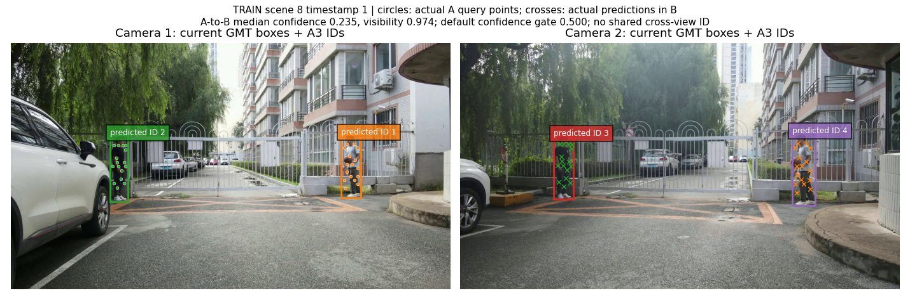

# GMT detector replacement and VGGT point association

Status: SINGLE_ROUTE_EFFECT_GATE_COMPLETE_TEMPORAL_OFFICIAL_V2_SEED24_CANCELLED_NO_MULTI_SEED_AGGREGATE. Registration date: 2026-10-23.

The user execution specification is the attachment
`72c424c4-a10d-471c-a81d-d2acf67a046b/Pasted text.txt`. It remains the
completion contract. Negative pilots do not stop the registered comparisons.

## Immutable baseline and isolation

All three new worktrees start from verified remote commit
`9a5572ebb3184b58253d448648195d175983ca1c`, tree
`f1110304b519c2561e38d06c88434989e85c51af`.

| Route | Branch | Local worktree |
|---|---|---|
| Detector replacement | `research/worldmot-gmt-detector-20261023` | `/data1/liuyeqiang/WWW_gmt_detector_20261023` |
| Pretrained point association | `research/worldmot-vggt-point-association-20261023` | `/data1/liuyeqiang/WWW_vggt_points_20261023` |
| Final comparison | `research/worldmot-gmt-point-comparison-20261023` | `/data1/liuyeqiang/WWW_gmt_point_comparison_20261023` |

The original experiment worktrees remain on their original branches.
The original ablation/evaluation queues are preserved. No-appearance and
two-stage are complete; the frozen V2 no-geometry ablation is now complete on
22/22 TEST videos and its official legal-scope metrics are recorded below.
The capacity TEST waiter PID 20615 was identity/cwd/owner/children checked
and suspended with SIGSTOP before it started TEST. Its checkpoints remain
preserved. Pause evidence is in
`/data1/liuyeqiang/nas/A100/WorldMOT/capacity_20261022/queue_pause_20261023.json`.

## Frozen comparison contract

TRAIN covers 24 scenes / 28,754 synchronized timestamps. Internal validation
uses scenes 4, 8, 12, 16, 20, 24; fitting uses the other 18 scenes before
refitting on all 24. TEST covers all 22 videos / 29,019 synchronized timestamps.
The metadata/data SHA must be checked against the original audit before runs.
Official scoring uses original unmodified GT on scenes
1,2,3,4,6,7,8,9,10,11,15,16,18,19. Scenes
5,12,13,14,17,20,21,22 retain their raw GT block and still require full inference.
All new primary outputs use `tracks_2d_by_camera` and current detection boxes.
The existing TrackEval/MATLAB adapters are reused unchanged.

Registered systems are GMT native, original RTMDet V1 and three-seed V2;
A0 GMTDet+IoU/motion; A1 GMTDet+appearance/motion;
A2 GMTDet+VGGT temporal points; A3 GMTDet+VGGT temporal/cross-view points;
B1 GMTDet+V1; B2 GMTDet+retrained V2 joint and no-geometry.
A4 point+Omega consistency is conditional on completing A3 and resource budget.
No new capacity architecture is part of this experiment.

GMT candidates must be captured before GTA/Track Bank/track IDs and pass
single-image versus causal-prefix equality. Shared caches contain detector
observations and features, never GT identities. A2/A3 retain every legal
current candidate as matched or newborn; point failure cannot erase a box.
VGGT's actual reference image is always first. Two anchor directions have
separate forwards and their costs are both measured.

Association settings are selected only on TRAIN. Point count candidates are
8/16/32, with 16 the preregistered default. Point confidence/visibility, minimum
support, NULL and finite history thresholds will be enumerated and locked
before TEST. The V2 initial matched budget is the prior 4 epochs, with the
existing internal validation procedure; any longer TRAIN budget must be
separately registered before new TEST inference.

## Resource and storage policy

User authorizes up to six V100 cards and parallel jobs where memory permits.
Admission checks actual occupancy and ownership. Other users' jobs are not
stopped. A shared-card run is labeled as such; comparable latency measurements
require exclusive single-card conditions. Four/six-card aggregate throughput
is not reported as video FPS. Host RAM was 66 GiB available at initial audit;
local `/data1` had 98 GiB free. Large artifacts use the verified SSHFS mount
`Valadmin@127.0.0.1:/home/A100` (3.7 TiB available), under:

* `/data1/liuyeqiang/nas/A100/WorldMOT/gmt_detector_comparison_20261023/`
* `/data1/liuyeqiang/nas/A100/WorldMOT/vggt_point_association_20261023/`
* `/data1/liuyeqiang/nas/A100/WorldMOT/final_comparison_20261023/`

Each milestone must include code/tests, configs/SHA, commands, real status,
failure evidence and small results on GitHub. Unmeasured entries are
NOT_AVAILABLE, never zero. Final reports must include per-scene/per-camera
metrics, detector-to-output recall, point evidence quality, failure attribution,
stage P50/P95, GPU memory and RGB-to-final-ID E2E FPS. Cache replay has its own
`association_replay_FPS` label. Experiments can complete with
NO_DEMONSTRATED_GAIN; scientific success requires actual measured benefit.

## Results

The GMT pre-GTA detector + fixed V1 association now has a complete official
TEST Gate. All 22 videos (29,019 synchronized timestamps) were inferred under
the frozen lock; the legal raw-GT scope is 14 scenes, with eight duplicate-key
GT scenes blocked without modifying GT. TrackEval on the valid scope is HOTA
48.48305, AssA 41.56007, DetA 56.87552, IDF1 53.07887, MOTA 67.83044, IDSW
2,761 and Frag 1,655. VisionTrack MATLAB is CVIDF1 52.52115 / CVMA 65.28177.
The complete provenance is in `results/gmt_v1_test_gate_complete_20261023.json`
and the raw official report is in
`results/gmt_v1_test_official_raw_metrics_20261023.json`.

The frozen VGGT-point joint TEST route is now complete on all 22 videos and
has an official legal-scope score. Its TrackEval result is HOTA 53.39746,
AssA 45.72730, DetA 62.82394, IDF1 57.73960, MOTA 75.47277, IDSW 1,194 and
Frag 1,562; VisionTrack MATLAB is CVIDF1 47.23269 / CVMA 34.11808. This is
the GMT pre-GTA detector plus the pretrained VGGT-1B TrackHead point-joint
route, not an Ω geometry result. It is below GMT Native by -12.66713 HOTA,
-22.37254 IDF1 and -30.82861 CVIDF1, while MOTA is +2.50916 and IDSW is
4,850 lower. The temporal point route is now also complete and is reported
below. The user stopped the unfinished multi-seed continuation before spending
more time on it; no new seed aggregate is produced in this first effect gate.

The frozen GMTDet 2D controls have also completed all 22 TEST videos and the
same official 14-scene legal scope. A0 IoU/motion obtains HOTA 57.65895 /
IDF1 64.33262 / CVIDF1 43.96730 / CVMA 18.79811 with 860 IDSW at 2.42080
mean full-video FPS. A1 appearance/motion obtains HOTA 58.21174 / IDF1
65.63601 / CVIDF1 50.97634 / CVMA 33.13223 with 662 IDSW at 2.37260 FPS.
Both are below GMT Native on identity metrics (A1: -7.85285 HOTA, -14.47613
IDF1, -27.08496 CVIDF1) but are substantially faster than the VGGT-point
route; they are 2D controls and must not be described as geometry gains. Gate
and stage-timing provenance is in `results/gmt_2d_iou_motion_test_gate_20261024.json`,
`results/gmt_2d_iou_motion_test_fps_20261024.csv`,
`results/gmt_2d_appearance_motion_test_gate_20261024.json` and
`results/gmt_2d_appearance_motion_test_fps_20261024.csv`.
The VGGT temporal and joint routes have now completed their registered
six-scene TRAIN full-video validation, full 22-video TEST inference and
official legal-scope evaluation under the frozen TRAIN-only lock.
Historical GMT/V2 TEST metrics are reference evidence only and are not
hyperparameter-selection data.

An early official-protocol V2 diagnostic is now recorded separately in
`results/gmt_v2_partial_legal_diagnostic_20261024.json` and its compact CSV.
The joint route was evaluated on all 14 legal raw-GT scenes and obtained
HOTA 61.01771 / IDF1 74.21891 / CVIDF1 72.69293 / CVMA 68.30677. The
no-geometry route at that observation point had only 12 legal scenes because
predictions for scenes 11 and 19 were missing; its diagnostic was HOTA
60.70615 / IDF1 73.89260 / CVIDF1 72.01332 / CVMA 67.94222. These are
partial legal-scope diagnostics, not the final full-22 route ranking; no
TEST parameter was selected from them. The joint route has since been rerun
and independently verified as a complete 22-video inference with the same
metrics hash; the auditable route gate is
`results/gmt_v2_joint_seed20261022_test_gate_20261024.json`, with per-scene
timing in `results/gmt_v2_joint_seed20261022_test_fps_20261024.csv`.
Its official legal-scope result is HOTA 61.01771 / IDF1 74.21891 /
CVIDF1 72.69293 / CVMA 68.30677, or -5.04688 HOTA and -5.89324 IDF1 versus
GMT Native. This is a completed frozen-seed route, not the final three-seed
V2 aggregate.

The independently frozen `joint_seed20261023` route has also completed all
22 TEST videos and the same 14-scene legal evaluation. It obtains HOTA
61.75587, AssA 63.83939, DetA 59.97305, IDF1 73.91947, MOTA 72.35661,
IDSW 506, Frag 1,210, MATLAB CVIDF1 72.46872 and CVMA 66.56743 at mean
shared-GPU E2E 0.723982 FPS (frame-weighted 0.712180; harmonic scene FPS
0.693824). This route is -4.30871 HOTA and -6.19267 IDF1 versus GMT Native;
it is another completed seed, not a multi-seed aggregate. Its Gate and stage
timing are in `results/gmt_v2_joint_seed20261023_test_gate_20261024.json`
and `results/gmt_v2_joint_seed20261023_test_fps_20261024.csv`. The registered
seed20261024 continuation was stopped before official evaluation; its three
complete and three partial scenes are audit-only in
`results/gmt_v2_joint_seed20261024_cancelled_20261024.json`.

The matched `no_geometry_seed20261022` ablation has also completed all 22
TEST videos and the same 14-scene legal evaluation. It obtains HOTA 59.20433,
AssA 59.70257, DetA 58.96238, IDF1 71.72844, MOTA 71.48247, CVIDF1 69.95230,
CVMA 64.28696, IDSW 699 and Frag 1,251 at mean shared-GPU E2E 0.75737
synchronized dual-camera timestamps/s (harmonic scene FPS 0.73037). Relative
to the matched joint seed, geometry adds +1.81338 HOTA, +2.49047 IDF1,
+2.74063 CVIDF1 and removes 101 ID switches; this is one-seed ablation
evidence, not the final three-seed V2 claim. The auditable files are
`results/gmt_v2_no_geometry_seed20261022_test_gate_20261024.json`,
`results/gmt_v2_no_geometry_seed20261022_test_fps_20261024.csv` and
`results/gmt_v2_geometry_ablation_20261024.json`.

### VGGT-point joint official TEST Gate (2026-10-24)

The frozen GMTDet + VGGT point-joint route completed all 22 TEST videos
(29,019 synchronized timestamps) with the live verified GMT pre-GTA detector,
32 deterministic person points, and no GT/track IDs in inference. The same
14 legal raw-GT scenes were evaluated by the official TrackEval and
VisionTrack MATLAB adapters; the eight duplicate-key raw-GT scenes remain
inference-only and were not repaired.

| Route | HOTA | AssA | DetA | IDF1 | MOTA | IDSW | Frag | CVIDF1 | CVMA |
|---|---:|---:|---:|---:|---:|---:|---:|---:|---:|
| GMTDet + VGGT Joint | 53.39746 | 45.72730 | 62.82394 | 57.73960 | 75.47277 | 1,194 | 1,562 | 47.23269 | 34.11808 |

Mean per-scene full-video E2E throughput is **0.452815 synchronized
dual-camera timestamps/s**; the frame-weighted throughput is 0.420882 and
the conservative harmonic scene summary is 0.404346. The VGGT model-only
stage is 0.629592 FPS when measured as timestamps divided by accumulated
aggregator plus TrackHead seconds. Global P50/P95 per-timestamp times are
2.00268/4.55325 s for RGB-to-final-ID delivery, 0.96403/2.20512 s for the
VGGT aggregator, 0.40128/0.98569 s for the TrackHead, and 1.69230/3.96535 s
for point-memory processing. The full stage/per-scene table is
`results/gmt_vggt_joint_test_fps_20261024.csv` and the provenance Gate is
`results/gmt_vggt_joint_test_gate_20261024.json`.

Against GMT Native, this route is -12.66713 HOTA, -22.37254 IDF1 and
-30.82861 CVIDF1, with +2.50916 MOTA and 4,850 fewer ID switches. Thus the
joint point association does not show a net identity gain in this official
route. This is a pretrained VGGT-1B TrackHead point experiment, not a
VGGT-Ω geometry experiment.

### VGGT-point temporal official TEST Gate (2026-10-24)

The frozen GMTDet + VGGT temporal route completed all 22 TEST videos and the
same 14-scene legal raw-GT evaluation. It obtains HOTA **52.46113**, AssA
**44.05928**, DetA **62.97203**, IDF1 **55.70791**, MOTA **75.50123**, IDSW
**1,158**, Frag **1,557**, MATLAB CVIDF1 **39.53578** and CVMA **18.78020**.
Compared with GMT Native this is **-13.60346 HOTA, -24.40423 IDF1,
-38.52552 CVIDF1 and -49.86327 CVMA**; MOTA is +2.53761 and IDSW is 4,886
lower. It therefore does not provide a net identity improvement.

Mean live shared-GPU full-video throughput is **0.654285 synchronized
dual-camera timestamps/s**; frame-weighted throughput is 0.649316, harmonic
scene FPS is 0.633927, and VGGT model-only throughput is 1.062184 FPS. The
stage P50/P95 and end-to-end timing are in
`results/gmt_vggt_temporal_test_fps_20261024.csv`; the official provenance and
metrics SHA are in `results/gmt_vggt_temporal_test_gate_20261024.json`. This
is a VGGT-1B TrackHead point route, not a VGGT-Ω geometry result.

### GMTDet 2D-control official TEST Gates (2026-10-24)

The selected A0 and A1 controls were evaluated with the same frozen detector
lock, RGB timestamps, output rules and official evaluator. Both produced all
22 TEST videos; only the 14 legal raw-GT scenes enter the aggregate. They do
not call VGGT, geometry or GTA.

| Route | HOTA | AssA | DetA | IDF1 | MOTA | IDSW | Frag | CVIDF1 | CVMA | mean E2E FPS |
|---|---:|---:|---:|---:|---:|---:|---:|---:|---:|---:|
| GMTDet + 2D IoU/motion (A0) | 57.65895 | 53.15544 | 63.08694 | 64.33262 | 75.67827 | 860 | 1,560 | 43.96730 | 18.79811 | 2.42080 |
| GMTDet + 2D appearance/motion (A1) | 58.21174 | 54.15544 | 63.03002 | 65.63601 | 75.79630 | 662 | 1,544 | 50.97634 | 33.13223 | 2.37260 |

Compared with GMT Native, A1 is -7.85285 HOTA, -14.47613 IDF1 and
-27.08496 CVIDF1, while reducing IDSW by 5,382. A0 is -8.40563 HOTA,
-15.77952 IDF1 and -34.09400 CVIDF1, while reducing IDSW by 5,184. The
approximately 2.4 synchronized dual-camera timestamps/s is a real live
detector-to-final-ID throughput, not the cached TRAIN replay speed. These
controls provide a fast reproducible 2D baseline but no measured identity
advantage over GMT Native.

The GMT pre-GTA detector + fixed V1 association has now completed its
official TRAIN validation Gate. All six registered validation videos are
covered (5,860 synchronized timestamps); the legal aggregate contains only
scenes 4/8/12 because raw GT in 16/20/24 has duplicate keys. TrackEval on the
valid scope is HOTA 48.27676, AssA 34.10812, DetA 69.06127, IDF1 49.17423,
MOTA 76.17674, IDSW 665 and Frag 180. The interleaved VisionTrack MATLAB
result is CVIDF1 48.00064 / CVMA 70.27261. This is a TRAIN-only diagnostic
Gate; it is not a TEST comparison or a claim of gain over GMT. Full provenance
is in `results/gmt_v1_train_gate_complete_20261023.json`.

## Completed first gates

The GMT raw adapter passes exact native-candidate parity, causal-prefix and
cross-environment immutable replay on real TRAIN images. The VGGT-1B weight
hash matches the official author's LFS pointer and four real TrackHead
component forwards pass. The merged two-route code is tested independently
of the still-running original experiment worktree.

On all six complete TRAIN validation scenes (5,860 synchronized timestamps),
raw GMT detection precision/recall is 96.4691%/89.9411%, versus RTMDet's
75.4120%/47.8545% at their registered native thresholds. Their detector
training histories differ (VisionTrack-trained GMT versus COCO RTMDet).
These are detection diagnostics and do not measure geometric identity gain.

On a shared 32-timestamp TRAIN Scene 8 pilot, both new routes deliver all
128/128 GT-matched detections. GMTDet+V1 shares the correct ID in 64/64
eligible cross-view events, whereas point A3 at the registered default
confidence gates shares 0/64. V1 yields two IDs, point A3 four. Measured live
pilot E2E is 0.590361 FPS for V1 and 0.196039 FPS for the corrected point
version. This small pilot is not the final complete-video comparison and
does not replace independent TEST evaluation. Point temporal support has
124/124 GT-consistent positive-support candidate pairs; these are distinct
from selected assignments and are not dense point ground truth.
The first point failure and the corrected-coordinate/lifecycle repeat are
both preserved on the point branch with exact inference source SHA.

Full TRAIN raw candidate extraction and full GMT+Omega object-feature
extraction initially ran in parallel, with disjoint per-worker scene lists and the
same immutable shared detector lock. The completed V1 TRAIN validation is
marked shared-GPU and its latency cannot be promoted to the final comparable
exclusive-GPU table. The point temporal and joint full-video TRAIN gates are
now complete; their shared-GPU timing is recorded separately from final TEST
latency.

The matched-budget V2 registration is four epochs for joint/no-geometry
internal fits, seed 20261022, using the original 18/6 TRAIN split. Thresholds
use the existing fixed-window TRAIN calibration procedure and complete
validation audit. Full 24-scene refits use joint seeds 20261022/23/24 and
no-geometry seed 20261022, also four epochs. This matching budget is fixed
before new TEST; any expansion requires a separate TRAIN-only registration.
The 32-frame subset fit is an engineering check and has no TEST permission.

Published result/source branches:

* [Detector route](https://github.com/LYQ1107/WWW/tree/research/worldmot-gmt-detector-20261023)
* [Point route](https://github.com/LYQ1107/WWW/tree/research/worldmot-vggt-point-association-20261023)

The live status is generated from `/proc`-verified owned processes plus actual
scene artifacts in `results/gmt_vggt_live_status.json`. It is a timestamped
snapshot, not a substitute for checking current process handles. The original
official baseline results, including source metric SHA and GT blocks, are in
`results/gmt_vggt_original_official_baselines.json`. Only routes without a
complete inference and official score remain NOT_AVAILABLE; the A0/A1 2D
controls now have independent official TEST gates below.

The complete raw GMT TRAIN gate has now passed deep verification of every
data shard and all 24 timelines: 557,002 observations / 57,508 RGB images,
1,041,985,391 compressed bytes, zero empty ROI descriptors. The independently
frozen detector now exports GT-free TEST candidates concurrently. The
registered V2 training/TEST controller and its actual process handle are
included in the generated live snapshot. The first V2 wave has completed the
joint seed-20261022 route gate above. The user stopped the seed-20261024
continuation before official evaluation, so no multi-seed route ranking or
aggregate is claimed in this first effect gate.
# Six-card execution and additional real evidence

The current allocation stays within physical V100 cards **0/2/3/4/6/7**.
Cards 0/2/6 run disjoint GMT+Omega object-cache partitions and fixed-rule V1
validation concurrently. Card 4 continues the original no-geometry TEST.
Cards 3/7 run disjoint TRAIN point-calibration scenes. The 2D controls first
calibrate on CPU/cache replay, then may share 0/2/6 for real detector TEST.
Full point TEST can use these same six cards after TRAIN selection, complete
validation and freezing; each worker waits for at least 16 GB free GPU memory
and 16 GB available host RAM. No other user's process is stopped. Concurrent
accuracy runs are labeled `shared_gpu`; combined card throughput is never
reported as one video's FPS.

Two genuine engineering failures are retained. The first V1 full validation
stopped at TRAIN Scene 4 timestamp 598, because Python float64 xyxy subtraction
and the immutable FP32 xywh cache differed by 0.0000076294 pixels. Candidates,
scores and ROI features were otherwise exact. The corrected adapter emits the
declared FP32 schema and real timestamps 597/598/599 pass strict equality.
The first visibility follow-up also failed: synthetic bbox sampling support
had been assigned to `det.mask`. That rectangle is now separate from a real
mask; all eight current projection rows in a real two-frame repeat pass.
Every array of a 32-timestamp, 128-observation object-cache rerun is bit exact.
Original failed streams, numeric evidence and source hashes remain available.

Both default point methods now cover all 523 TRAIN Scene 8 timestamps:

| Method | Shared candidates / outputs | Selected temporal identity consistency | Correct shared cross-view IDs | E2E FPS, unoptimized |
|---|---:|---:|---:|---:|
| A2 temporal | 1999 / 1999 | 1949 / 1961 | 0 / 936 (disabled by design) | 0.217704 |
| A3 joint | 1999 / 1999 | 1949 / 1961 | 0 / 936 | 0.174433 |

These fixed-IoU post-hoc TRAIN diagnostics are not official TEST scores or
dense point ground truth. Positive-support candidate edges are now reported
separately from selected ID transfers. The default A3 gate has demonstrated
no cross-view identity benefit on this complete scene.

A model-only audit found official TrackHead recomputes the same image-independent
sinusoidal grid in every refinement iteration. Process-local caching of this
104,109,712-byte constant preserves genuine pretrained xy/visibility/confidence
outputs exactly. The paired three-image, 32-query-anchor benchmark has a 5.7387x
warm model-only speedup. A separate controlled 32-timestamp real MOT run on
exclusive GPU 3 includes RGB decode, live GMT detection, both anchored forwards,
memory and flushed final IDs: **0.191291 -> 0.594831 FPS (3.10956x)**. Every
delivered ID, point-evidence value and association decision is bit exact.
Median paired VGGT model time is 4.50912 -> 0.970596 s; the difference from the
component benchmark reflects its different query count/input setting. This is
a speed result on a short TRAIN prefix, not full-video quality or TEST FPS.

The finite point budget is registered in
`configs/gmt_point_train_budget_20261023.json`: 18 settings per A2/A3, six
validation scenes, 32-frame start/middle/end windows (648 independent windows;
20,736 processed timestamps across settings). Exact-request replay keys contain
original RGB bytes, image order, exact FP32 queries, weights/source/precision;
there are no GT or identity labels. This replay accelerates TRAIN calibration
and never supplies system E2E FPS. The selection objective is explicitly named
`TRAIN_window_identity_consistency_F1`, with formula and tie breaks in code.
It is not an official MOT metric. Selected settings must next complete all six
validation videos and official TRAIN evaluation before a TEST lock is written.
Final point TEST uses live GMT and real forwards, retaining only the proven
image-independent constant-grid cache.

A0 uses IoU plus constant box-velocity prediction; A1 uses the independent
frozen GMT ROI descriptor plus motion and current cross-view appearance.
Neither calls GTA, VGGT, GT calibration or 3D geometry. The fresh 2026-10-24
TRAIN gate exhausted the preregistered three A0 IoU settings and nine A1
IoU/cosine settings, then completed all six validation videos and official
TRAIN evaluation. The selected settings are A0 IoU=0.3 and A1 IoU=0.5,
cosine=0.7. On legal TRAIN scenes 4/8/12, A0 obtains HOTA 67.19296 / IDF1
72.33212 / CVIDF1 45.57407, while A1 obtains HOTA 69.35764 / IDF1 75.45918 /
CVIDF1 59.79462; scenes 16/20/24 remain blocked by raw GT duplicate keys.
These are TRAIN-only diagnostics. The controls preserve all current candidates
with NULL/newborn decisions and use the frozen TEST lock. Their complete live
TEST gates are recorded separately in the two `gmt_2d_*_test_gate_20261024.json`
files; replay FPS remains distinct from live TEST FPS. Already separate IDs
are not retrospectively merged in this simple 2D control.

The original two-stage ablation has also completed 22/22 TEST videos and the
official legal-GT scope: HOTA 35.19849, AssA 47.59979, IDF1 41.57418,
MOTA 31.89188, IDSW 373. Its 65,580 true positives and 124,205 misses explain
why fewer ID switches are not evidence of superiority to GMT. The VGGT-point
temporal route is now complete; the V2 seed aggregate is intentionally not run
in this first effect gate. No threshold is chosen from
the historical two-stage TEST reference.
The merged CPU suite passes 79 tests, including NULL assignment, mask
semantics, box storage precision, exact model-request replay integrity and
causal 2D lifecycle tests.

The first-frame failure is rendered directly from RGB and actual forward
outputs, without GT input:

Dots are actual Camera A query points; crosses are actual predictions in B,
colored by the source predicted identity. Their median cross-view confidence
is 0.235 despite median visibility 0.974. The registered 0.5 gate rejects
this evidence. The full finite scan measures whether relaxing confidence also
admits wrong-person matches. To get an earlier diagnostic without adding a
new setting, the already registered K=16/confidence=0.2/support=0.1 A3 first-32
window is executed separately on shared GPU 3. Its result is not a freeze or
a substitute for all-window selection and full-video validation.

The early registered K16/c0.2/s0.1 run is complete: all 128 detections are
delivered with two IDs; 64/64 shared-GT cross-view events have the correct
shared ID, with zero observed different-person merges in this 32-frame
window. All 124 selected temporal transfers are GT consistent. This is a
short two-person TRAIN diagnostic. Its measured 0.573900 FPS is on a shared
GPU and is excluded from the main full-TEST comparison. The all-window scan
and selected complete-video validation remain required; no threshold has
been selected from TEST or promoted based on this prefix alone.

The registered all-window TRAIN scan has now completed. Its selected A2/A3
settings are temporal `points_per_person=16, minimum_confidence=0.3,
minimum_support=0.2` and joint `points_per_person=32,
minimum_confidence=0.2, minimum_support=0.1`. The complete six-scene
full-video TRAIN gate is recorded in
`results/vggt_point_train_gate_complete_20261024.json` and the compact
metrics table is `results/vggt_point_train_metrics_20261024.csv`. On the
legal raw-GT scope (scenes 4/8/12), temporal obtains HOTA 65.81177 / IDF1
69.21970 and joint obtains HOTA 66.14742 / IDF1 69.99049. Joint is slightly
better on this TRAIN diagnostic (HOTA +0.33565, IDF1 +0.77079), but it is
also slower (0.44038 versus 0.65468 harmonic six-scene FPS). This is a
TRAIN-only gate; no official TEST metric or final route ranking is implied.

The frozen point TEST lock is now valid (`TEST_used_for_selection=false`),
and the live point TEST stage starts with joint. The first-wave joint worker
needed an auditable recovery for missing scene manifests (scenes 4, 6, 10,
12, 16, 20, 21); all recovered outputs are full-video and are listed in the
JSON gate artifact. The eight raw-GT-blocked scenes remain blocked without
modifying GT.

`build_gmt_point_comparison.py` creates the required partial official main
JSON/CSV, error-attribution JSON and FPS CSV. The completed point TEST score
and the single-seed V2 route scores are reported above; no aggregate V2 TEST
score is produced in this first effect gate. The completed joint seed-20261022
route is reported separately above and is not used to select TEST parameters. Short TRAIN speed,
model-only throughput and historical complete TEST throughput have distinct
scope labels. Raw per-frame timing aggregation for legacy P50/P95 remains
explicitly pending.

### V1 official TEST Gate (2026-10-23)

The fixed V1 detector-replacement route completed all 22 TEST videos. Its
shared-GPU per-scene E2E timing is recorded in
`results/gmt_v1_test_fps_20261023.csv` (mean 0.72091, median 0.80882,
minimum 0.26183 synchronized dual-camera timestamps/s). Because these are
concurrent accuracy runs, they are not an exclusive single-video latency
ranking. The eight raw-GT-blocked scenes are retained as inference coverage
but excluded from the official aggregate; the new point and V2 routes cannot
be compared scientifically until their own complete official gates exist.
