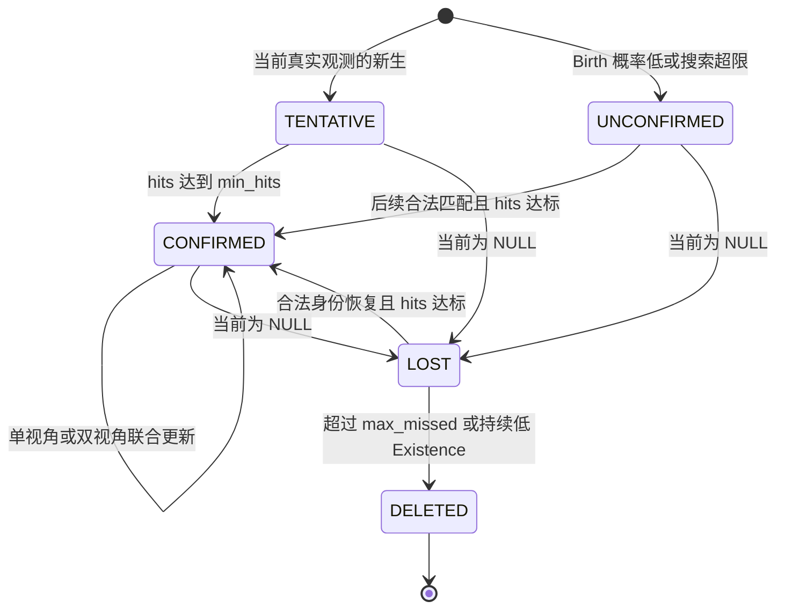

# WorldMOT V3：持续世界对象的联合观测归属

状态：`CODE_REPAIR_COMPLETE_WAITING_USER_APPROVAL`。本文描述代码行为，不包含新实验结果。

## 数据流

旧实现（源提交 `190c735`）：

```text
检测 A/B → 几何分数排序 → 贪心预合并 → Hypothesis → 历史 Bank 匹配
```

V3：

```text
完整同步 RGB → 冻结 GMT 检测、真实 ROI 特征 ─┐
完整同步 RGB → Ω512 → 相机深度与静态世界对齐 ├→ WorldObjectObservation
冻结缓存 → SHA/候选一一对应校验、只读 ROI 联结 ┘             │
                                                         ▼
历史 World Object Bank ───────────────→ 联合身份假设 / NULL / Birth
                                                         │
                                      小分量精确求解 / 大分量有限 Beam
                                                         │
                                      分配完成后构造对象 Measurement
                                                         │
                                    分开更新空间状态和长期身份表征
                                                         │
                            当前 GMT Box + Camera ID + Global ID + Score
                                                         │
                                             下一时刻复用持续状态
```

`WorldObjectTrackingCore` 是唯一正式身份核心。Live 和 Replay 只负责生成观测。
正式路径不调用 `JointWorldObjectBuilder.build()` 进行预融合；该兼容接口仅生成 singleton。
`legacy_worldobject_*_v1.py` 只被独立 E0/E1 对照入口导入，正式核心不导入它们。

## 实际接口

| 模块 | 函数签名 / 职责 |
|---|---|
| `data/worldobject_observations.py` | `live_observations(detections, frame, world_transform, *, min_confidence=1.5, use_geometry=True)` |
| 同上 | `replay_observations(frame)`，拒绝目标身份字段 |
| `runtime/world_object_tracking_core.py` | `WorldObjectTrackingCore(config, model=None, device="cpu", *, training=False)` |
| 同上 | `reset(scene_id)`；`step(observations, timestamp, *, scene_id=None, evidence=None, training_decision=None)` |
| 同上 | `forward_evidence(observations, timestamp, training=False)`，真实历史 ID 参与打分 |
| `tracking/joint_world_object_assignment.py` | `JointWorldObjectAssignment(config).assign(history, observations, learned=None)` |
| `models/multi_view_world_object.py` | `assigned_measurement(observations, object_id, feature_dim, use_geometry=True)`，仅在分配后融合 |
| `tracking/persistent_world_object_bank.py` | `PersistentWorldObjectBank(config).step(observations, timestamp, learned=None, *, training_decision=None)` |
| `models/world_object_model_inputs.py` | `model_inputs(history, observations, config, timestamp, device="cpu")` |
| `training/world_object_causal_training.py` | `CausalWorldObjectTraining(core, history_mode="predicted").step(observations, timestamp, labels, optimizer=None)` |

`training_decision` 是 forward 之后的 TRAIN teacher correction；推理核心默认拒绝此参数。
训练和推理共用同一个 Bank、输入构造器、几何更新器和 embedding 更新器。

## 状态与生命周期

每个对象保存 `global_id / center / covariance / support_points / geometry_valid`，以及独立的
`identity_embedding / identity_confidence / recent_view_features`。另外保存摄像头可见性、
最后观测时间、age、hits、missed、生命周期和当前决策原因。



`LOST` 不输出预测检测框。新生未确认对象仍输出它的当前真实检测框，避免通过删框降低 IDSW。
同一时刻一个对象每台摄像头最多接受一个观测；一个检测只属于一个对象。
Global ID 在场景内单调递增，DELETED ID 不复用；场景重置清空历史和编号空间。

## 几何失败与资源边界

对齐失败时，Live 不将旧 Transform 用于当前 Ω 点图。当前 ROI 可参与视觉恢复，
空间状态保留；没有足够身份证据时建立未确认/新生对象。`WorldFrameTransform.timestamp`
必须等于当前几何帧时间。当前无观测的视角不写入伪特征。

默认限制：每对象每相机 Top-K=4，Beam=64，小分量状态上限4096，观测/历史各1024，
可学习头最多65,536个对象—观测对。搜索超限采用显式 singleton 未确认新生，保留全部框；
推理模型对数超限记录 `LEARNED_PAIR_LIMIT_RULE_EVIDENCE_FALLBACK`，训练则报错，禁止静默丢样本。

这是一套两摄像头在线 MOT 接口，不是完整4D重建接口。真实数据性能、显存和精度尚未验证。
