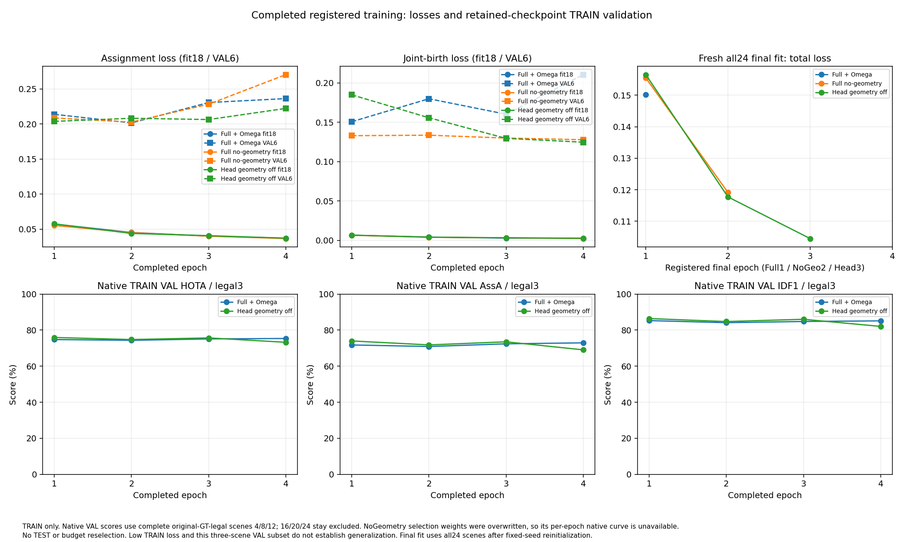
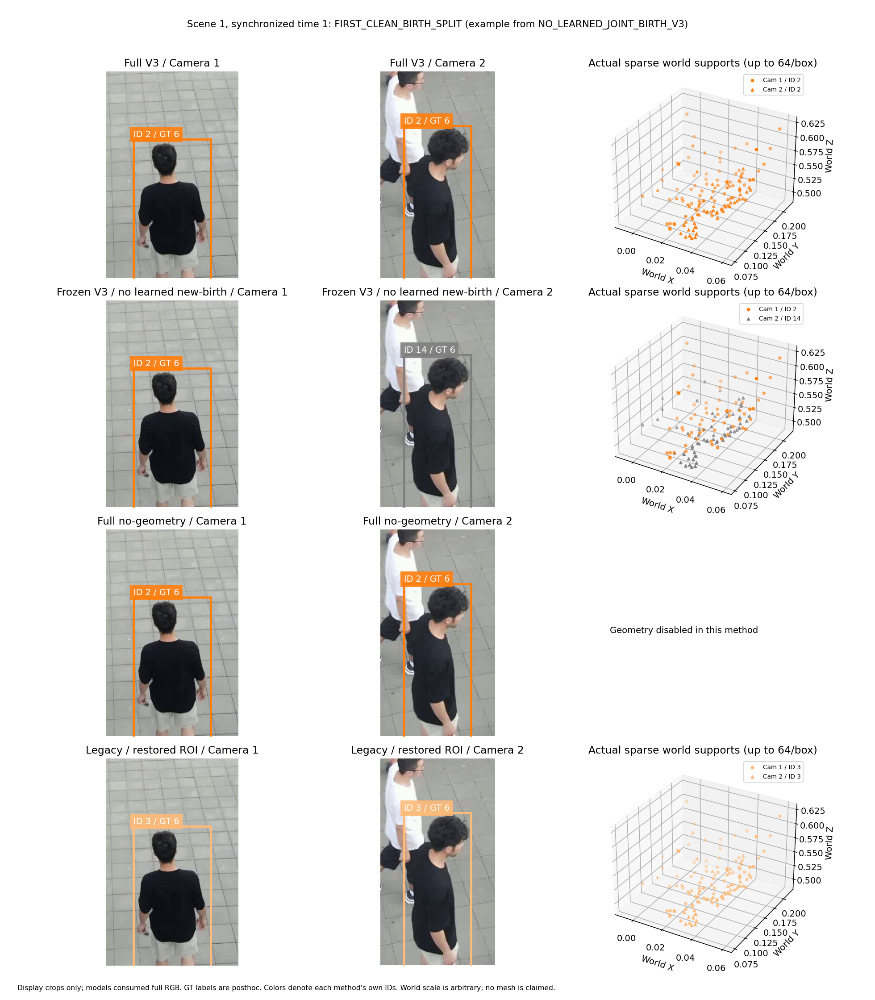

# WorldMOT V3 R2：完整训练与独立 TEST 最终报告

**结论：NO_INDEPENDENT_GEOMETRY_GAIN。** 本轮 Full V3＋Ω 没有获得独立的整体身份关联收益；Head 去显式几何输入版本也低于 Full No-Geometry。三个正式模型均已完成原定训练、22/22 TEST 推理及 14 个合法完整场景的 TrackEval＋MATLAB。R2 冻结参数和正常任务没有被重启或依据 TEST 调整。

## 正式 TEST 指标

各行使用原始 GT 和相同合法14完整视频协议。八个原始 GT 不合法场景完成推理但排除正式汇总。IDSW、Frag 来自 TrackEval；CVIDF1、CVMA 来自未修改的 VisionTrack MATLAB，不能混用两套 CLEAR 的 IDSW。

| 方法 | HOTA | AssA | IDF1 | CVIDF1 | MOTA | IDSW |
|---|---:|---:|---:|---:|---:|---:|
| GMT native reference | 66.0646 | 69.5787 | 80.1121 | 78.0613 | 72.9636 | 6044 |
| GMTDet + V2 reference | 61.0177 | 60.2274 | 74.2189 | 72.6929 | 75.4564 | 598 |
| GMTDet + V1 reference | 48.4831 | 41.5601 | 53.0789 | 52.5212 | 67.8304 | 2761 |
| Full V3 + Ω | 56.4218 | 50.7806 | 63.9655 | 61.8413 | 74.6619 | 2837 |
| Full No-Geometry | 60.4318 | 58.2867 | 70.1622 | 67.6049 | 75.0228 | 2130 |
| Head geometry off / bank geometry on | 56.9114 | 51.7687 | 63.9155 | 61.3976 | 74.7346 | 2673 |
| Frozen Full / learned new-Birth off | 56.4550 | 50.8522 | 63.8804 | 61.7423 | 74.4748 | 3194 |
| Rule-based joint world objects | 55.8426 | 49.9174 | 62.3462 | 59.9447 | 74.3352 | 3415 |
| Legacy pair-then-merge / ROI on | 48.4494 | 37.9175 | 48.3536 | 47.6306 | 62.0708 | 26585 |
| Legacy pair-then-merge / features off | 44.2136 | 31.8520 | 43.4013 | 42.7549 | 61.2635 | 28063 |
| Geometry-only / no appearance | 33.8755 | 18.8493 | 33.3721 | NA | 52.0078 | 45751 |

Full 相对 No-Geometry：HOTA -4.0100、AssA -7.5061、IDF1 -6.1967、CVIDF1 -5.7636 个百分点。Full 与 Head 都未追平 V2 或 GMT。不同方法经过同一 TRAIN-only 规则选择，但最终训练预算分别为 1/2/3 个 epoch；这是预注册完整系统比较，不是同权重几何开关。

Geometry-only 的 TrackEval 完成全部合法14场景；MATLAB 原生评分在注册的 1800 秒限制后超时，部分任务保留，CVIDF1 为 NA。没有用短片段、清洗 GT 或自定义指标填补。其他当前方法 MATLAB 均完成。

| 方法 | TP | FP | FN | DetA | Frag |
|---|---:|---:|---:|---:|---:|
| GMT native reference | 165338 | 20820 | 24447 | 63.0665 | 1584 |
| GMTDet + V2 reference | 153813 | 10010 | 35972 | 62.1099 | 1289 |
| GMTDet + V1 reference | 137246 | 5753 | 52539 | 56.8755 | 1655 |
| Full V3 + Ω | 165346 | 20812 | 24439 | 63.1085 | 1566 |
| Full No-Geometry | 165335 | 20823 | 24450 | 63.0806 | 1575 |
| Head geometry off / bank geometry on | 165333 | 20825 | 24452 | 63.0268 | 1588 |
| Frozen Full / learned new-Birth off | 165347 | 20811 | 24438 | 63.0961 | 1570 |
| Rule-based joint world objects | 165325 | 20833 | 24460 | 62.9742 | 1568 |
| Legacy pair-then-merge / ROI on | 165272 | 20886 | 24513 | 62.8131 | 1708 |
| Legacy pair-then-merge / features off | 165245 | 20913 | 24540 | 62.4327 | 1749 |
| Geometry-only / no appearance | 165306 | 20852 | 24479 | 62.2313 | 1845 |

当前八个方法每个均输出 548,583 个原始检测候选；合法14为 186,158 个。三主模型逐条与冻结 GMT 缓存核对，完整八方法审计再次核对所有 key、bbox 和 score。TP/FP/FN 的小差异属于正式匹配结果，不是修改检测框。V1/V2 历史系统的输出筛选策略不同，不能将与它们的召回差单独归因为关联模型。

## 为什么 IDSW 更低，全球身份却更差

No-Geometry 的同人跨视角拆分为 11,662/54,452；151 个有干净检测匹配的人物中 123 个对应过多个 Global ID。不同人跨视角误合并 1,515 次，其中 1,514 次复用了已有 ID。独立相机里持续使用不同 ID，或稳定复用错误 ID，都可能只有较少局部切换，却损害全视频跨视角一一身份对应。

Full 相比 No-Geometry 在固定候选诊断中纠正 3,219 次同人拆分、新增 1,011 次（净 +2,208）；纠正 1,111 次异人误合并、新增 493 次（净 +618）。但纠正 1,403 次时间身份变化、新增 2,132 次（净 -729）。这些是完整合法14的 IoU=.5 干净匹配诊断，不是官方 IDSW 或 CVIDF1。

Full 的累积混合 ID 数为 186，No-Geometry 为 177；混合 ID 内少数人物观测从 6,481 增至 10,877。干净匹配的一一身份保留观测从 126,055 降到 115,245。瞬时跨视角融合改善与持久身份污染同时存在。这里测量的是输出 ID 历史，不能等同于测量神经特征的污染。

## 固定 TRAIN VAL 的真实机制诊断

Full/Head 保存的选择期 checkpoint1–4 共八次重放均覆盖原定六个 VAL 场景、每次 5,860 对时刻/172,760 检测，全部精确复现原诊断计数。原始 GT 合法的 4/8/12 才进入正式 TRAIN VAL TrackEval；16/20/24 的干净子集只作诊断。No-Geometry 选择权重1–4在归档前被覆盖，未重训、替代或伪造其原生逐 epoch 曲线。

| 模型 / 选择 epoch | 正确恢复 | 恢复相机下一帧换 ID | 新 ID | 实际几何拒绝 |
|---|---:|---:|---:|---:|
| Full V3 + Ω / 1 | 6 | 6 | 1 | 5 |
| Full V3 + Ω / 2 | 6 | 6 | 1 | 5 |
| Full V3 + Ω / 3 | 8 | 8 | 0 | 6 |
| Full V3 + Ω / 4 | 7 | 7 | 1 | 6 |
| Head geometry off / bank geometry on / 1 | 7 | 6 | 1 | 6 |
| Head geometry off / bank geometry on / 2 | 7 | 7 | 2 | 6 |
| Head geometry off / bank geometry on / 3 | 5 | 5 | 1 | 4 |
| Head geometry off / bank geometry on / 4 | 7 | 7 | 2 | 6 |

上述事件都在 TRAIN Scene24，都是单视角历史身份恢复，尚不是两视角已共享同一 ID 的成功融合。必须跟随发生恢复的相机，排除另一相机此前已有的分裂。旧 any-view 计数和原预测保留；Head epoch1 的变化计数由7更正为6。各行重复同一批视频，不能累加为独立样本。

Full 选择 epoch1 的具体例子：t704 的 ID158 视觉恢复后旧空间位置仍有效、missed 清零；t705 余弦0.9743、学习 margin4.9267仍被距离11.4044对门槛6的几何检查拒绝，产生 ID162。该真实频率很低，不能解释所有4,160次 TRAIN诊断时间变化。

NULL 按实际训练损失的 sigmoid(null−max assignment) 校准，不能把 raw null≥0 当作同一概率。Full epoch1 虽然 raw 正计数为0，相对概率≥.5却有8,169次；Brier .04145、十箱 ECE .02675。Existence 均值 .99954 对应注册保留窗口下 .99922 的正目标率，不能据此单独宣称塌缩。完整 bins、Birth 原始/相对概率、提案及选择漏斗均已保存。

修正过去但由模型判断当前的129时刻前缀实验，Full拆分738→554、误合并508→291；Head744→500、351→171。当前错误仍显著存在，且历史目标池改变。用GT直接修正当前决定后的零错误只是上界，不是模型成功。该实验仅为 TRAIN 前缀诊断。

固定状态 Birth 反事实另对 Full/Head 选择 checkpoint1 的完整六场景重放，基线均精确复现。Full 实际选中错误联合Birth为0；只删除新联合Birth选项时，错误融合仍为3,056，同人拆分增加29。Head实际错误联合Birth为1，删除后误融合仅少1，同人拆分增加31。故原始高分错误候选不能当作最终Birth错误。

在相同候选图中人为删除历史竞争者，并将正Birth收益改为阈值logit+1e-6和singleton logit−60所对应的极小正值，Full/Head会出现3,537/5,860次错误联合Birth。这验证零singleton基线的结构性可能性，却不是R2自然发生频率。固定相同logit/历史而关闭求解器几何项（门控和几何加分均关闭），Full/Head的瞬时误融合从3,056/2,071变为4,329/2,370；这不是重新训练的No-Geometry系统。所有反事实决定被丢弃，未来仍沿用真实R2状态。见 `worldobject_v3_frozen_birth_counterfactual.json`。

## 同设备真实速度：有限 live 诊断

以下为相同物理 V100 上 TEST1/8/22 各100组同步双图，共300对时刻的实际 RGB→冻结检测器→关联→ID落盘。包括首帧；RGB到ID分布排除模型初始化和帧间计时日志，整 worker吞吐另列。它不是全22视频运行FPS，也不是六卡总吞吐。

| 方法 | RGB→ID FPS（对/秒） | 含启动整 worker FPS | P50 ms | P95 ms |
|---|---:|---:|---:|---:|
| Full V3 + Ω | 0.6424 | 0.5715 | 1436.928 | 2065.630 |
| Full No-Geometry | 3.3655 | 2.5765 | 266.279 | 349.607 |
| Head geometry off / bank geometry on | 0.7140 | 0.6190 | 1295.402 | 1804.182 |
| Frozen Full / learned new-Birth off | 0.6485 | 0.5756 | 1413.268 | 2121.042 |
| Rule-based joint world objects | 0.6431 | 0.5737 | 1395.954 | 2097.995 |
| Legacy pair-then-merge / ROI on | 0.6164 | 0.5501 | 1594.519 | 2067.395 |

Full 的 Ω 纯前向平均179.178ms（5.5810对/秒），Ω后端wall391.123ms，世界对齐495.969ms，支持提取311.779ms。纯GPU前向不能冒充端到端速度；嵌套阶段不能重复相加。完整阶段P50/P95、原始日志和采样显存见 runtime_breakdown.csv。GMT/V1/V2 的历史全22视频wall FPS 分列，不与这个短样本直接宣称速度胜负。

## 正式 TEST 失败可视化

六个固定候选、相同帧的原始RGB显示裁剪、实际ID和Ω稀疏世界支持图已保存；每个框最多64个支持点，不是完整人体网格。颜色表示各方法自己的ID，GT只在预测完成后标注。选取规则、原审计哈希和每张图的哈希见 `results/worldobject_v3_full_TEST_failure_figures/manifest.json`。

其余同人拆分、异人误合并和首次干净检测拆分图位于同一目录；这类例图不替代完整合法14的统计。

## 六个预注册问题的回答

1. **旧W3/W4为什么低？** 旧W3/W4合法14 HOTA分别41.0227/37.0917，旧 ROI 缺失/停用与几何输入问题都有影响。ROI独立效果必须看新 ROI-on 减 feature-off，不能把跨版本全部提升算给ROI。当前表保留这两个相同几何的控制。
2. **联合求解好于先配对后合并吗？** Rule joint相对新Legacy ROI-on，HOTA变化 +7.3933，CVIDF1 +12.3141。这是完整V3/legacy控制组比较，也包含记忆及保留策略差异，不能把全部差值因果地归到求解器。它仍低于GMT。
3. **学习联合Birth独立有效吗？** 相同Full权重关闭新Birth学习路径后，Full HOTA差 -0.0332，CVIDF1差 +0.0990，证据很小且并非各指标一致。此控制保留历史pair证据并回退启发式新Birth，不能解释为去掉训练loss。
4. **Ω有独立整体收益吗？** 本次Full相对No-Geometry四个主身份/关联指标均下降；Head版本也未胜过No-Geometry。存在单时刻跨视角净纠错，尚未转成完整视频身份收益。
5. **比V1/V2/GMT如何？** Full超过V1，但低于V2和GMT。相对GMT有MOTA/IDSW数值优势，同时全球身份更差；不能据此宣称主要目标成功。速度比较遵循上方不同范围限制。
6. **世界对象状态是否只是名字？** 空间状态确实参与门控并能改变当前ID；真实恢复后旧状态拒绝下一帧的证据可复现。它目前也是错误来源。此系统依赖独立二维检测后提升至稀疏世界支持，不是已训练的原生3D人物检测头，也不能把方法名当成三维MOT成功证据。

## 独立 R3：只做受限 TRAIN 归因

分支 research/worldmot-v3-r3-state-update-fix-20261025 对视觉恢复后的旧空间状态作失效处理，保留身份，等待后续可靠当前观测初始化位置。203项CPU测试通过。同一R2选择期权重、六个TRAIN VAL场景的一次无优化器重放，净纠正同人配对10、异人配对22、时间身份变化60；全部在原始GT不合法的Scene24干净子集。合法3个VAL场景的官方HOTA/AssA/IDF1完全不变。R3没有正式MOT增益证据，没有进行TEST或六卡长训。R3结果提交 eb97b22f7a256169496788564dd124cacd636e15。

## 范围、checkpoint与复核

模型/输入源码指纹：`6bcdcdb1a6b3683c4e406b0791416a77e5e9e64f165fbad4a61667698b64645f`。GMT只提供冻结检测/ROI并作为独立评分参考，未使用其跟踪器决定本方法ID。未修改 WWW/main、旧WorldMOT分支或原始GT。

| 模型 | 最终all24 epochs | checkpoint SHA-256 |
|---|---:|---|
| Full V3 + Ω | 1 | `cfda40050e89b31dd4480ca4d5010e23067a94ba18ea7d0e2425d5935d3f7fb8` |
| Full No-Geometry | 2 | `b08badfc634c9652a34366951c93207fa321deb7d1a2b240a76798f11607053f` |
| Head geometry off / bank geometry on | 3 | `dbf1d81d6440641f4b6864557fe9cd6dd349ef8d54ce48446f510b87d1f0142a` |

TRAIN唯一28,754对时刻/57,508图像；TEST唯一29,019对/58,038图像。训练前18/6选择四个epoch，固定seed20261025，hidden128；然后重新初始化在全部24场景训练注册预算。64步clip不重置ID，只有真正场景边界重置。身份头436,870参数；Ω为冻结的1,143,814,185参数512原版权重，并非416复现。权重、缓存和完整轨迹留NAS，GitHub提交代码、报告、统计及可视化。

正式表：`results/worldobject_v3_final_comparison.csv`；机器结论：`results/worldobject_v3_final_status.json`；全视频归因：`results/worldobject_v3_identity_error_attribution.json`；Birth：`results/worldobject_v3_birth_pair_analysis.json`；完整运行范围：`worldobject_v3_fulltrain_coverage.json` / `worldobject_v3_fulltest_coverage.json`；各阶段速度：`worldobject_v3_runtime_breakdown.csv`。

详细 TRAIN 科学诊断、生命周期校准、恢复相机频率、真实失败图及全部8次保留checkpoint指标均在同目录对应JSON和 `WORLDOBJECT_V3_R2_SCIENTIFIC_DIAGNOSIS.md`。此前执行记录移至 `WORLDOBJECT_V3_R2_EXECUTION_HISTORY_20261025.md`，不以旧结果代替本轮测量。
