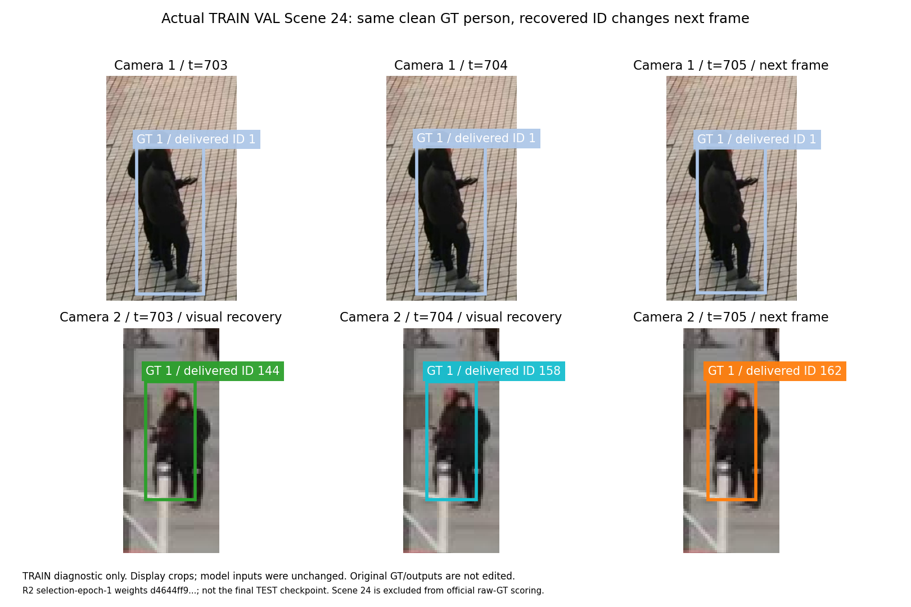

# WorldMOT V3 R2 scientific diagnosis

This is the completed TRAIN diagnostic audit of the frozen R2 experiment,
authorized by attachment `294ae6fe-469b-43f7-9d7b-3e0a3512409e`. It does not
change training, thresholds, selected budgets, frozen assignments or TEST inputs.
The model/input source fingerprint remains
`6bcdcdb1a6b3683c4e406b0791416a77e5e9e64f165fbad4a61667698b64645f`.
No R3 training or additional seed is started.

## Measured execution state

Full no-geometry completed four selection epochs, selected two final epochs,
then actually trained all 24 scenes twice. Each final epoch processed 28,754
paired times and 539,738 clean matched identity observations. Its final checkpoint
SHA is `b08badfc634c9652a34366951c93207fa321deb7d1a2b240a76798f11607053f`.
The source/weight/coverage gate is verified; its 22-video TEST inference has
completed, with native TrackEval/MATLAB scoring and a true live sample.
Full V3 and head-only no-geometry completed four selection epochs. The unchanged
TRAIN-only rule selected final budgets of one and three epochs respectively.
Full finished its all24 final epoch, with checkpoint SHA-256
`cfda40050e89b31dd4480ca4d5010e23067a94ba18ea7d0e2425d5935d3f7fb8`;
all22 TEST inference and legal14 native scoring are complete. Head-only finished
three final all24 epochs, passed its gate and completed full22 TEST/native legal14 scoring. Its checkpoint
SHA is `dbf1d81d6440641f4b6864557fe9cd6dd349ef8d54ce48446f510b87d1f0142a`.
Four parameter-free controls completed
all-24 TRAIN replay and full row/checksum/candidate-equivalence checks.

The first all-24 no-geometry epoch also has 438 observed preserved clip boundaries,
24 empty history states at true scene origins, finite model parameters, nonzero
birth-pair weight updates and 28,754 optimizer steps. Its intermediate snapshot
is preserved on NAS, separately from the selected final checkpoint. This proves
actual training flow; it is not TEST accuracy evidence.

## Current identity evidence

After selection epoch 1 on the fixed six TRAIN VAL scenes, Full V3 has 4,834
same-person splits, 3,056 different-person merged pairs and 4,160 diagnostic
temporal ID changes. Full no-geometry has 5,865 / 3,232 / 2,664; head-only
no-geometry has 5,790 / 2,071 / 2,878. Thus the current cross-view aggregate
improvement coexists with temporal regression. Independent net geometry benefit
and superiority to GMT are not established.

These TRAIN counts are not official IDSW, HOTA, AssA, IDF1 or CVIDF1. Full
no-geometry now has official legal-14 HOTA 60.4318, AssA 58.2867, IDF1 70.1622
and CVIDF1 67.6049, below GMT and V2. MOTA 75.0228 exceeds GMT 72.9636 while
identity scores remain lower. Full's formal HOTA/AssA/IDF1/CVIDF1 are now
56.4218/50.7806/63.9655/61.8413, all below No-Geometry. The registered Full-vs-
NoGeometry contrast therefore shows no independent geometry gain. Head's
HOTA/AssA/IDF1/CVIDF1 are 56.9114/51.7687/63.9155/61.3976, also below the
No-Geometry control. No parameter or budget is changed using TEST. See
`results/worldobject_v3_no_geometry_official_test.json` for hashes and live timing.

The training key `first_appearance_split_count` is defined by the actual target
builder as a split of a model-history-absent same-person birth pair. It is not
restricted to first appearance in the video. Existing raw keys/counts are kept;
the main report label is corrected. Event attribution will separately measure
first clean visibility and absence from prior predicted history.

The existing `teacher_prefix_*` ID counts are measured after the teacher-forced
current assignment correction. They are not the learned solver's current
decisions with only a corrected past. A clean-history causal comparison must
inspect the normal solver before that correction; zero oracle-corrected ID
errors alone do not prove learned model accuracy or isolate exposure bias.

The corrected-past normal-current shadow audit is now measured. It uses the
same already registered 129-time prefix per six VAL scenes (774 times per
retained selection1 model), clones the teacher-past bank and invokes the ordinary
GT-free current assigner before current teacher correction. Two regression
tests verify that the clone does not mutate original state. Original predicted
prefix split/merge counts reproduce exactly.

| Prefix diagnostic | Full predicted past | Full teacher past / normal current | Head predicted past | Head teacher past / normal current |
|---|---:|---:|---:|---:|
| Same-person splits / 4,224 pairs | 738 | 554 | 744 | 500 |
| Different-person merges / 202,133 pairs | 508 | 291 | 351 | 171 |
| Wrong or unlabelled historical reuse observations | 1,312 | 960 | 959 | 812 |
| New-ID observations despite some clean matching active history | 14 | 278 | 20 | 306 |

Teacher-corrected past reduces some pair errors while substantial current
decision errors remain; it does not resolve the method. The last outcome's
historical target pools also differ, so it is not a same-denominator Birth-head
precision comparison. Teacher-corrected CURRENT decisions give zero clean pair
errors by construction and remain a ceiling, not learned prediction accuracy.
These prefixes are TRAIN-only diagnostic scope, not full-video TEST scores.
See `results/worldobject_v3_teacher_past_normal_current_shadow.json`.

## Frozen R2 birth-utility probes

Nine CPU tests cover eight birth-utility scenarios and a three-method spatial
recovery probe, without real data
or training. With no competing history, a wrong pair just above the registered
threshold can have a strictly positive benefit and beat two zero-benefit
singleton births, even when the singleton prior is extremely small. At exactly
zero benefit the tested solver keeps the singleton baseline. A correct historical
competitor can defeat the weak wrong pair; reliable conflicting geometry can
veto it. Four raw wrong high-score pairs can yield two selected wrong merges,
illustrating why raw Pair FP is not a final false-merge count.

The result is in `results/worldobject_v3_birth_utility_synthetic.json`; tests are
in `analysis/test_worldobject_v3_birth_utility_diagnostic.py`. This establishes a
synthetic structural possibility, not its real TRAIN frequency or causal share
of R2 errors. All available retained-checkpoint funnels and the complete
six-scene frozen-state counterfactual are measured below. A relative utility
change is not applied to R2 or trained in R3.

The frozen-state Full/Head selection1 replay exactly reproduces the original
baseline diagnostics. Actual selected wrong Joint Births are 0/1 despite
13,233/19,194 raw high wrong pairs. Of those raw pairs, 12,658/18,488 have at
least one endpoint covered by a clean correct historical option. Removing
all new joint-Birth options keeps Full's 3,056 wrong historical two-view
merges unchanged and removes only one Head false merge, while introducing
29/31 more same-person splits.

Artificially removing historical competitors and making retained positive
benefits tiny yields 3,537/5,860 wrong joint births. This is a hypothetical
stress case on actual fixed TRAIN graphs, not R2's observed error frequency.
Identical-logit solver-geometry-off raises Full/Head instantaneous wrong merges
from 3,056/2,071 to 4,329/2,370. The raw internal mode name mentions gates, but
this intervention removes both geometry gates and geometry evidence bonuses;
it is not a pure hard-gate toggle or a retrained NoGeometry model. Hypothetical
decisions never update subsequent history. Full details and scene/density/
appearance/reliability strata are in
`results/worldobject_v3_frozen_birth_counterfactual.json`.

An additional frozen-source probe gives the same person correct shared IDs in
both views after a spatial-conflict visual recovery, then assigns a new shared
ID on the immediately following identical observation. The recovery preserves
the old spatial center but clears `missed` to zero; the next spatial conflict
therefore lacks the recovery exception. Full and head-only geometry reproduce
this behavior while full no-geometry retains the original ID. These are synthetic
world units, not measured physical motion. The first real TRAIN frequency and
margins are measured below; R2 is not patched in place.

## Lifecycle probability semantics

The actual NULL loss uses `sigmoid(null_logit - max_current_assignment_logit)`,
with current score zero when there are no observations. The legacy count
`null_logits >= 0` is not that trained conditional NULL probability. A near-zero
raw activation count alone therefore does not establish lifecycle failure.
Calibration must join this relative probability, clean masked target and actual
solver NULL outcome. Existence supervision also includes the registered retention
window, so a high positive rate must be interpreted against that target policy.
All eight available retained-checkpoint probability/outcome audits are complete;
selection epoch1 is expanded below.

All eight available real retained-checkpoint replays are now complete: Full and
Head-only selection epochs 1–4, all six fixed TRAIN VAL scenes / 5,860 synchronous
times / 172,760 current detections each. All eight exactly reproduce every comparable
original epoch diagnostic count; the observer changes no decisions or state.
The detailed numbers below
refer to these **selection** weights, not the final all24-refitted TEST weights.

| Actual TRAIN VAL event | Full epoch 1 | Head-only epoch 1 |
|---|---:|---:|
| Correct selected spatial-conflict visual recoveries | 6 | 7 |
| Same person cleanly detected immediately next frame | 6 | 7 |
| Recovered camera changes ID on the next frame | 6 | 6 |
| Next-frame actual new ID | 1 | 1 |
| ID break with correct history actually geometry-rejected | 5 | 6 |
| New ID with retained stale center and geometry rejection | 1 | 1 |
| High-score DIFFERENT-person pair candidates | 13,233 | 19,194 |
| Selected DIFFERENT-person joint Births | 0 | 1 |
| Final DIFFERENT-person merged pairs, all paths | 3,056 | 2,071 |

All recovery events in this first pass occur in Scene 24's clean annotation
subset. Its raw GT is not legal for official scoring. Most next-frame changes
reuse another existing ID rather than creating a new one. Thus the exact
synthetic stale-position/new-ID mechanism does occur in real TRAIN, but these
small counts do not establish that it explains most temporal errors.

These are **single-view historical recoveries**. None of the observed selected
recovery groups in the eight replays already shared one ID across both cameras.
The raw observer's any-view change count also counted another camera's existing
split. A posthoc refinement follows only the recovered camera and corrects the
Head epoch-1 change count from 7 to 6; one recovery actually retains its ID there.
Original traces and raw counts are preserved, and four dedicated regression
tests cover this definition. No R2 prediction or formal metric changes.
Full's Scene 24 timestamp 704→705 is one concrete instance: recovered ID 158
keeps its old center and resets missed=0; next-frame appearance cosine 0.9743
and learned identity margin 4.9267 still lose to spatial distance 11.4044
against gate 6, and the affected detection receives new ID 162.

The plotted boxes and IDs are actual immutable TRAIN outputs with clean GT
labels joined afterward. Camera 1 retains ID 1; Camera 2 cycles 144→158→162.
This is a display crop of the original RGB, not cropped model inference, and
it is not the final TEST checkpoint or an official Scene 24 result.

Full's actual trained NULL-margin probability has 8,169 values ≥.5 despite
zero nonnegative raw NULL logits. Its mean probability is .04821 versus a
positive-target fraction .07172, Brier .04145 and ten-bin ECE .02675.
Existence averages .99954 against .99922 positive targets under the retention
policy. These measured target/probability results replace claims of lifecycle
collapse inferred from raw-logit counts alone. The JSONs also report raw Birth
and history-relative softmax calibration, with exact sample counts and bins.

Unchanged TrackEval on complete legal TRAIN VAL scenes 4/8/12 yields Full
HOTA 74.7869 / AssA 71.7914 / IDF1 85.2940 and Head-only 75.9365 / 74.0132 /
86.4258. The other three fixed VAL scenes 16/20/24 are excluded from that
official protocol without editing GT. These are TRAIN VAL metrics and cannot
be compared with GMT's legal14 TEST aggregate as an improvement claim.

Epoch 2 separately gives Full 6 correct spatial recoveries, 1 next-frame new ID,
and 5 ID breaks with actual geometry rejection; Head-only gives 7 / 2 / 6.
These counts are repeated evaluations of the same VAL videos with different
weights, so they must not be pooled as independent real-world events.

The complete recovered-camera frequencies are:

| Model / selection epoch | Correct recoveries | Recovered-camera ID changes | Actual new IDs | Changes with actual geometry rejection |
|---|---:|---:|---:|---:|
| Full / 1 | 6 | 6 | 1 | 5 |
| Full / 2 | 6 | 6 | 1 | 5 |
| Full / 3 | 8 | 8 | 0 | 6 |
| Full / 4 | 7 | 7 | 1 | 6 |
| Head / 1 | 7 | 6 | 1 | 6 |
| Head / 2 | 7 | 7 | 2 | 6 |
| Head / 3 | 5 | 5 | 1 | 4 |
| Head / 4 | 7 | 7 | 2 | 6 |

Every row reuses the same six videos; do not sum the rows as independent events.
Every actual new-ID event above also has the retained stale center and a direct
geometry rejection in the recovered camera. This attributes a reproducible
mechanism, while the much larger temporal error totals require other causes.

Evidence is in `results/worldobject_v3_retained_TRAIN_VAL_summary.json`,
`results/worldobject_v3_recovered_view_frequency_refinement.json`, and the
birth, lifecycle, geometry and spatial/temporal attribution JSONs. They explicitly
say all eight available retained replays are complete. No-Geometry selection
weights remain unavailable as documented below.
A separate R3 branch, `research/worldmot-v3-r3-state-update-fix-20261025`, prepares
spatial abstention after accepted visual recovery. Its package plus three new
regressions pass 203 CPU tests. One fixed-weight TRAIN-only replay is registered
after diagnostic GPU release; no R3 optimizer or long training is started.

That registered R3 TRAIN-only replay is now complete. Same-person pair outcomes
have 25 corrections / 15 regressions; different-person pairs 100 / 78; temporal
comparisons 389 / 329 (+60 net). All changes occur in Scene24's clean subset,
which is excluded from original raw-GT official scoring. Legal TRAIN VAL
4/8/12 metrics stay exactly unchanged. Refined R3 recovery counts are five
single-view recoveries, three next-frame ID retentions, two changes and zero
new IDs or stale-geometry rejections in the recovered camera. This validates
the bounded state repair mechanism without demonstrating formal MOT gains.
The separate R3 result commit is `eb97b22f7a256169496788564dd124cacd636e15`;
R2 remains untouched, and no R3 long training or TEST inference starts.

## Input-equivalence audit

The actual old-support-plus-readonly-ROI route has been compared with the new
correct-camera-depth route over all 24 TRAIN scenes, 28,754 paired times and
557,002 candidates. Bbox/score/D1024 ROI inputs are bitwise identical, and the
current GT labels and supervision masks match; see
`results/worldobject_v3_input_equivalence_train.json`. The audit checks scene,
timestamp, camera, detection key, bbox, score, normalized D1024 ROI bytes/tolerance,
current clean GT labels and supervision masks. Geometry is the intentional
difference. Historical labels can differ as a consequence of predicted history;
that is distinct from a current-input or annotation mismatch.

The legacy sparse container does not always store an explicit RGB hash. Both
appearance routes are bound to the same immutable GMT raw cache RGB hashes and
exact image IDs; explicit sparse RGB hashes must also agree. The first audit
attempt assumed that optional legacy field was mandatory and exited before
comparing data. The observer assumption was corrected, the failed attempt is
preserved, and R2 training/cache files were untouched. This is not evidence of
an ROI/data mismatch. The full TEST equivalence pass also passed all22 / 29,019
times / 548,583 candidates with bitwise-identical bbox/score/ROI and no TEST GT
access; see `results/worldobject_v3_input_equivalence_test.json`.

## Checkpoint retention and limits

A separate observer watches atomic `resume.pt` replacements and copies complete
checkpoints with SHA verification/source binding. It sends no training signals,
writes no training files and creates no CUDA context. Full/head-only selection
epochs 1–4 are all retained and SHA-bound to their original training boundaries.
The inventory is `results/worldobject_v3_epoch_snapshot_inventory.json`.

No-geometry selection checkpoints 1–4 had already been overwritten before this
addendum. Original aggregate/periodic logs remain, but they cannot reconstruct
all original per-frame decisions or exact per-epoch HOTA/AssA/IDF1. Those results
must remain unavailable unless an authentic historical checkpoint is found.
No retraining or pre-R2 checkpoint is substituted. Final-refit TRAIN replay is
also distinct from held-out selection VAL because the final model has seen all
24 TRAIN scenes.

## Completed scope and retained limitations

The birth, temporal, lifecycle, geometry and spatial/temporal JSON files contain
real event joins for all eight available retained replays. The TRAIN-only R3
counterfactual, frozen-state Birth audit, all22 TEST geometry/Birth contrasts,
legal14 native primary scoring and six registered true-live samples are complete.
No-Geometry's completed all22 posthoc TEST attribution is documented separately
in `WORLDOBJECT_V3_R2_NO_GEOMETRY_IDENTITY_ATTRIBUTION.md`; it does not choose R2
parameters or substitute for the Full-vs-NoGeometry formal TEST comparison.

The geometry-only control has legal14 TrackEval but an actual 1800-second native
MATLAB timeout; its CVIDF1 remains unavailable. All three trained primary methods
have complete TrackEval/MATLAB. NoGeometry selection weights1–4 remain unavailable
and are not fabricated. R2 source and selection rules stayed frozen throughout.
